# Mario Zechner (@badlogicgames): Pi Android app ("pi mobile" / "p2") research bundle

Compiled Tue Oct 20, 2026 (PT) for Will Hampson's phone agent. **This file is self-contained**: you do not need X/Twitter access. Every tweet quoted below is reproduced in full, with its link for reference only.

> **Note for the reading agent: everything you need is in this repo.** All screenshots and video keyframes are stored next to this file under `docs/research/media/` and embedded below with relative links, each with a written description of what is visible. The `x.com` and `t.co` links are kept only as provenance (where each post came from). You don't need them, and they won't work for you: X requires a login and a browser, and the videos are represented here by still frames because you can't play them.

**Sources**: (a) 15 tweets verified by Will via the X API (marked "verified via X API"); (b) a scrape of Mario's posts (`_db.json` on Will's box, `/workspace/badlogic-torture/`); (c) screenshots and video stills of those posts, reviewed for an earlier handoff (`HANDOFF.md`) and spec (`SPEC.md`) on the same box, now copied into `docs/research/media/` and described in section 2 and in the Media section (§7); (d) Mario's public benchmark repo `badlogic/durable-bench` (script `harness/scripts/slayer.sh`, `harness/README.md`, `harness/Dockerfile`).

**Conventions**
- All times are Pacific Time (America/Los_Angeles, UTC-7 in October 2026), labeled "PT". Tweet timestamps were converted from UTC.
- Evidence tags: **[Mario]** he said it in a post; **[media]** seen in a screenshot of his post (the file is in `media/`); **[video]** from still frames / reviewer notes of his videos (videos were not reviewed with audio; the frames are in `media/<tweetid>/`); **[bench]** from his durable-bench repo; **[inferred]** our reading, not confirmed by him.
- Mario's app was first called "pi mobile" / "Pi Mobile" (Android package `works.earendil.pi.mobile`), and by Oct 11 appears as **p2** (`p2.mariozechner.at`). Will's own project is **p2w** / `Whamp/pi-mobile`. Don't confuse them.
- Glossary: **brain** = the agent loop (model calls, transcript); **hands / execution env** = where tools like `bash`, `read`, `edit` run; **durable** = every step checkpointed so a killed process resumes; **replay-safe** = a tool that may safely re-run after a crash (`bash` is not); **codemode** = model writes a JS script that calls tools (`await tools.bash(...)`); **steer** = message injected into a running turn.

---

## 1. TL;DR: key findings

- **Native Android app announced Sat Oct 4, 2:12 PM PT** [Mario, 2106855108680024232]: "android native app achieved,.no more termux needed ... not a product, but a pi durable demo. built in 2 days on my phone with .. pi durable." It is a bespoke app built from parts ripped out of Termux (userland emulation + background keep-alive) [Mario, 2111366160205987847, 2111369852111786259]. Runs on a **Pixel 11, not rooted, a few hundred MB RAM with many sessions** [Mario, 2111342152513208371]. Despite "no more termux needed", Termux paths and a "Termux 1 session" notification still appear Oct 11 [video 2109413968552820840] and on Oct 16 he says the "termux process is forcibly kept alive via a setting" [Mario, 2111214825154179397]. Which one is his daily runtime by Oct 19 is unclear.
- **Brain on the phone, only the tools move.** "everything except the llm runs on my phone" [Mario, 2107236034199126242]. On Oct 5 the agent switched its execution environment from the phone to a remote host *in the same session*; "it's brain stays on my phone" [Mario, 2107238740230078520]. The agent loop, transcript, durable storage, UI server and artifacts stay on the phone; only tool calls (bash/read/edit/...) run remotely over SSH [media 2107238740230078520: "The commands run over SSH on slayer"].
- **Slayer = Mario's remote server `slayer.marioslab.io`.** Screenshot: "I'm on the remote host slayer (slayer.marioslab.io), which runs Ubuntu 22.04 on x86_64, signed in as badlogic", cwd `/home/badlogic/pi-mono` [media 2107238740230078520]. His benchmark script describes it as "the dedicated host 'slayer'" with an **i9-13900** and **Docker** (it builds and runs a `dhb-bench` container there) [bench]. An Oct 12 screenshot (probably slayer [inferred]) shows Linux 5.15 x86_64, uptime > 1 year, `/dev/md2` 1.7T. Asked "Slayer is your remote session in hetzner vm?" he answered "no, just a remote execution env i can switch my phone agent too" [Mario, 2112092325237145858].
- **Slayer is distinct from his Hetzner box.** He separately says parakeet speech-to-text runs "on my hetzner" [Mario, 2112119334046667011]. Confusingly, the Oct 5 tweet text says "e.g. my hetzner" while its screenshot shows slayer. Best reading: slayer and "my hetzner" are two different machines; slayer is the one his phone agent switches its tools to [inferred from 2112092325237145858 + screenshot].
- **How he reaches slayer (from his benchmark script, `harness/scripts/slayer.sh`)** [bench]:
  - Host: `badlogic@slayer.marioslab.io`, overridable with env var **`SLAYER_HOST`**.
  - SSH key: `${SLAYER_KEY:-$HOME/.pi/mobile/ssh/keys/slayer}` (env var **`SLAYER_KEY`**).
  - Known hosts: `$HOME/.pi/mobile/ssh/known_hosts`; **`HostKeyAlias=pi-env-slayer`**; `StrictHostKeyChecking=yes`, `BatchMode=yes`, `ConnectTimeout=30`.
  - "The host drops bursts of new connections": the script retries SSH connection failures (exit 255) up to 5 times with linear backoff (`sleep i*15` s).
  - Docker container pinned with `--cpuset-cpus=4` ("one hardware thread of a P-core on the i9-13900"), `--memory=8g`.
  - **Caveat**: these values come from his *benchmark* script, not from p2's own config (p2 is private). The `~/.pi/mobile/ssh/...` paths and the `pi-env-<name>` alias pattern strongly suggest the script reuses the SSH material that pi mobile's env feature created [inferred]; pi-env (`@earendil-works/pi-env`) also deploys its daemon to `~/.pi/mobile/tools/` (per SPEC reading of pi source).
- **Oct 11 durable codemode restart test (12 steps)** [media 2109402647933702520, video 2109408108896563242]:
  - Script: `mkdir -p /tmp/durable-codemode && echo "start $(date +%T)" >> /tmp/durable-codemode/restart.log`; then `for i in 1..12`: `try { await tools.bash({command: \`sleep 10; echo "${i} $(date +%T)" >> /tmp/durable-codemode/restart.log; echo ${i}\`}); results.push("i: ok") } catch (e) { results.push("i: error " + first line of e.message) }`; finally `cat` the log and `return { results, log }`. Tools ran on slayer.
  - Kill method shown on screen: "On SIGTERM the worker closes the Harness first and exits after at most 1.5 s. So archiving is either a clean Harness close or, if that takes longer, a hard kill." He **archives** the session mid-run from the Session sheet, then **restores** it from the Archived tab.
  - Expected results listed on screen (= pass criteria): **no duplicate numbers** in the log; the **in-flight call reports interrupted and is caught**; **the rest continue** on their own.
  - Observed in the video: calls 1-2 OK (~10 s each), call 3 in flight; archived at ~0:31, restored at ~0:34; call 3 shows red **"Tool bash was interrupted and may have partially run"** (bash is not replay-safe, so it is not blindly re-run), the `catch` fires, and call 4 starts by itself. No step ran twice; treated as a pass. His comment: "all these things just fall out of durable execution in pi durable" [Mario, 2109408108896563242]. (pi-durable 1.2.0, Oct 12, shipped "durable codemode": the script is replayed from a journal of prior results and reattaches to in-flight tool calls.)
- **Oct 19 "phone dev" session** [media 2112085863408812097]: header `phone dev`, cwd `slayer:/home/badl…`; the agent explains: "This session's tools run on slayer, but the session itself runs in p2 on your phone." A Python script on slayer generated audio clips as MP3 inside an HTML file (`~/voice-bench/voice-test-f.html`, base64); a codemode script read it via `bash` in **45 KB chunks** (`tail -c … | head -c …`), each chunk travelling back to the phone as tool output; the script joined them and called the `artifact` tool, which saved it **on the phone under `~/.pi/p2`**. Footer: Claude Opus 5.5 · high, cost $220.41, context 16%/1.00M. Tunnel still `pim.ngrok.p…` in the URL bar.
- **His Termux advice** [Mario, 2111369852111786259]: "just point your agent at termux repo and say: i just need the usrrland emu and the background process stuff so my shit doesn't die."
- **Code state**: "it's not in a good state :D" [same tweet]. Oct 5: "decided to not publish this" [2107121062655774922]. Oct 11: pi durable is published; "the only thing we haven't published yet is this app ... soon" [2109416099200565580]. Oct 4: "we may release this little experiment next week, mayhaps" [2106707737048715303]. **As of Oct 20, 2026 the p2 source is private and unreleased; no repo or APK has been published** (none found in the captured posts).

---

## 2. Chronological timeline (all captured posts)

58 posts: every tweet ID in HANDOFF.md and SPEC.md, every post with saved media, the 15 API-verified tweets, and the @viticci context post. Quoted text is exact (`t.co` short links are left as captured; you cannot open them and they add no information here). Each post's attached media is embedded right under it. Texts marked "verified via X API" were supplied by Will; others come from the scrape. No tweet was left without text.

### Fri Oct 2, 2026, 12:20 PM PT (@badlogicgames)
Link: https://x.com/badlogicgames/status/2106102082512339446

> neat! that reminded me that some said pi works in termux on Android early this year. still does! https://t.co/6jU8ey3d5v https://t.co/eMjMiw7sGw

- Significance: Starting point: plain pi (the coding agent) still runs in Termux on Android.
- Text source: _db.json
- Media (local copies in `media/`):

**Video `2106102082512339446_0.mp4`** (1:59 long; 12 keyframes taken with ffmpeg; no audio reviewed; the mp4 is not in the repo (too large); only these stills are):

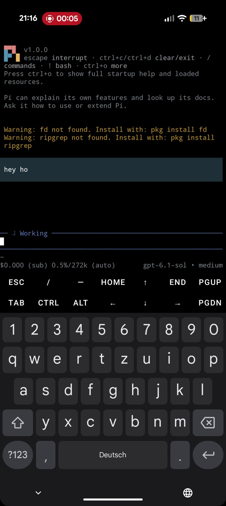

Caption (frame-01.jpg, 0:05): pi v1.0.0 TUI in Termux: startup hints, warnings "fd not found. Install with: pkg install fd" and "ripgrep not found…"; user prompt "hey ho", "Working"; status `$0.000 (sub) 0.5%/272k (auto)  gpt-6.1-sol • medium`; Termux extra-keys row (ESC / HOME END PGUP, TAB CTRL ALT PGDN) and Android keyboard.

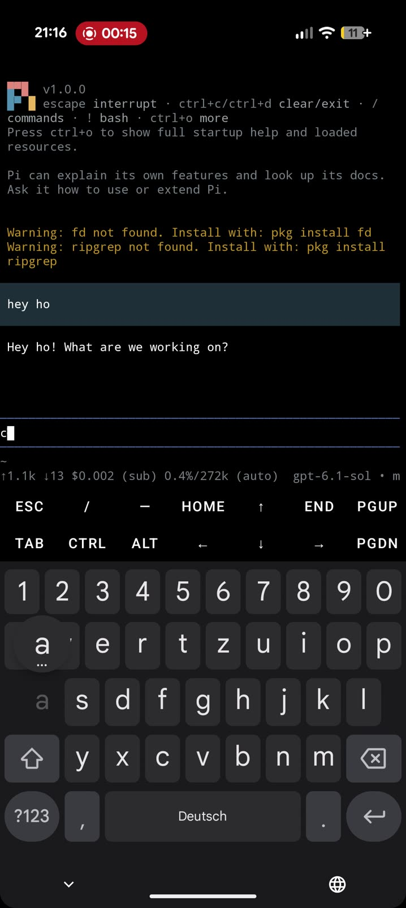

Caption (frame-02.jpg, 0:15): Agent replies "Hey ho! What are we working on?"; user starts typing.

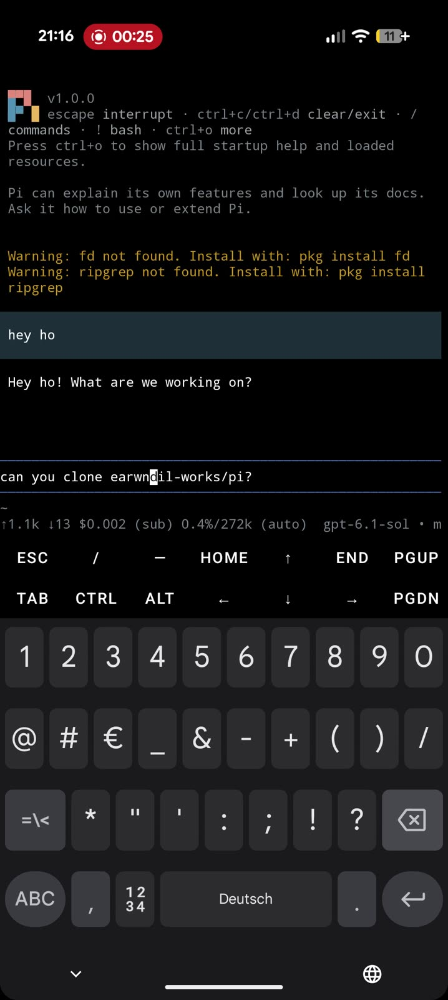

Caption (frame-03.jpg, 0:25): User types "can you clone earwndil-works/pi?" (typo in the input).

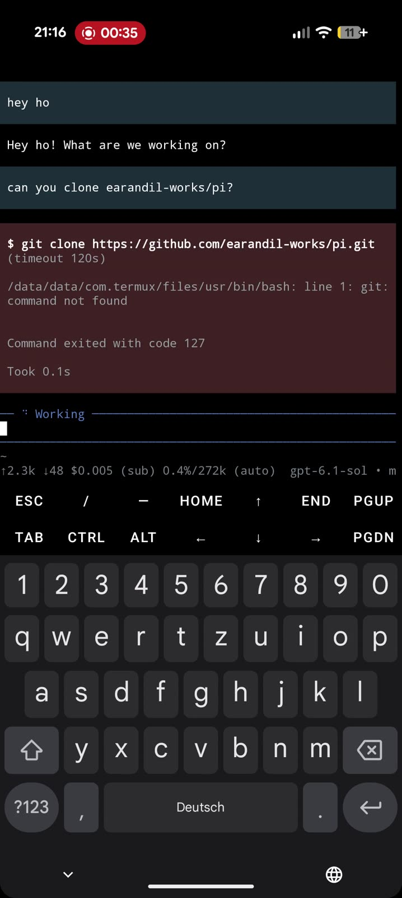

Caption (frame-04.jpg, 0:35): `$ git clone https://github.com/earendil-works/pi.git` fails in a red block: "/data/data/com.termux/files/usr/bin/bash: line 1: git: command not found", exit code 127.

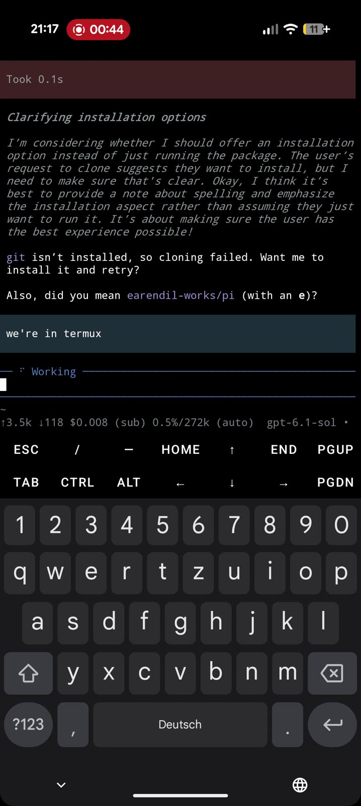

Caption (frame-05.jpg, 0:45): Thinking block "Clarifying installation options"; agent: git isn't installed, offers to install it, asks "did you mean earendil-works/pi (with an e)?"; user: "we're in termux".

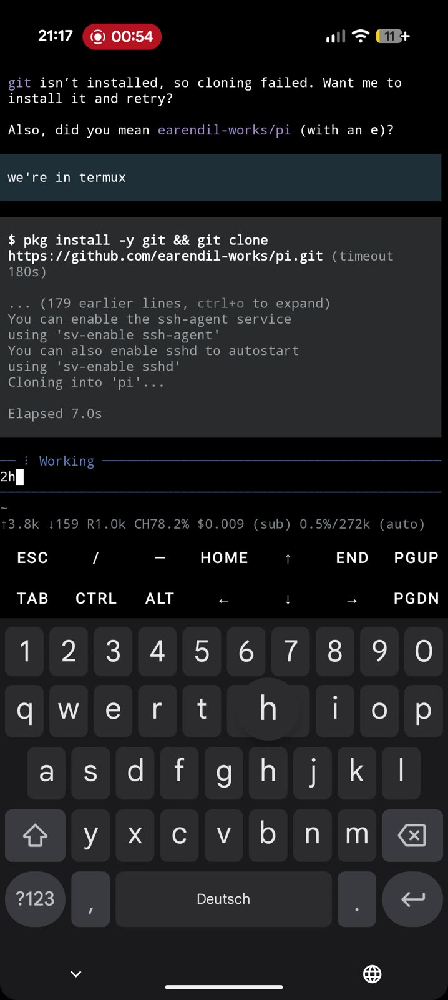

Caption (frame-06.jpg, 0:54): `$ pkg install -y git && git clone https://github.com/earendil-works/pi.git` running (output mentions `sv-enable ssh-agent`, `sv-enable sshd`, "Cloning into 'pi'…", Elapsed 7.0s).

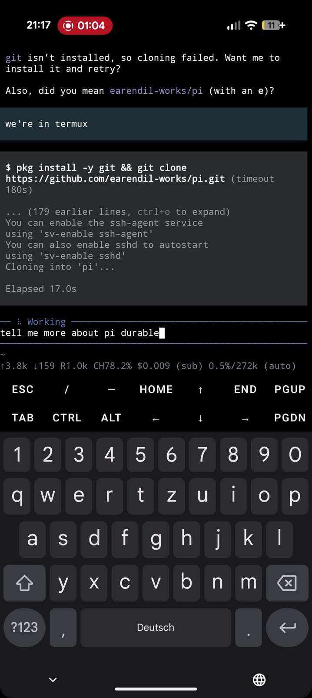

Caption (frame-07.jpg, 1:04): Same install still running (Elapsed 17.0s); user types "tell me more about pi durable".

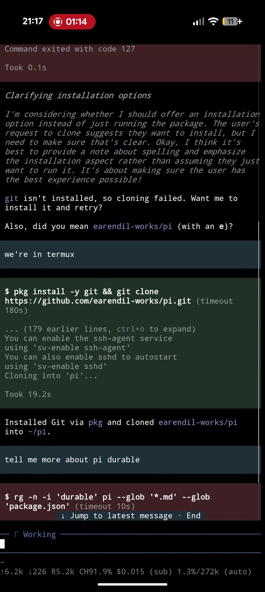

Caption (frame-08.jpg, 1:14): Scrolled transcript: clone finished (Took 19.2s), "Installed Git via pkg and cloned earendil-works/pi into ~/pi."; next command `rg -n -i 'durable' pi --glob '*.md' --glob 'package.json'` starting.

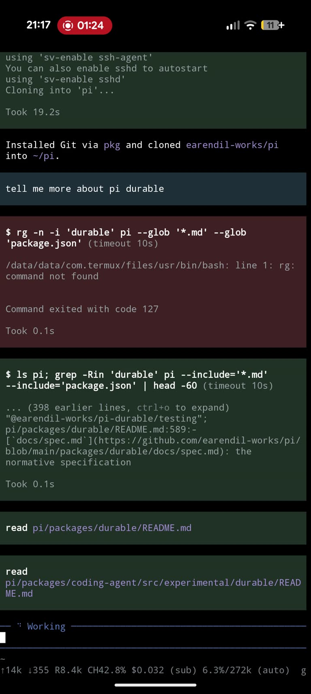

Caption (frame-09.jpg, 1:24): `rg` fails ("rg: command not found", exit 127); fallback `ls pi; grep -Rin 'durable' pi --include='*.md' --include='package.json' | head -60` finds `@earendil-works/pi-durable/testing` and `pi/packages/durable/docs/spec.md`; then `read pi/packages/durable/README.md` and `read pi/packages/coding-agent/src/experimental/durable/README.md`.

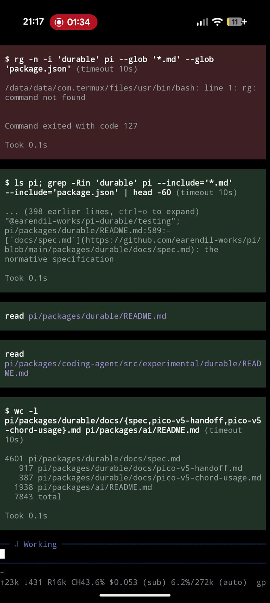

Caption (frame-10.jpg, 1:34): `wc -l pi/packages/durable/docs/{spec,pico-v5-handoff,pico-v5-chord-usage}.md pi/packages/ai/README.md` → 4601 spec.md, 917 pico-v5-handoff.md, 387 pico-v5-chord-usage.md, 1938 ai/README.md, 7843 total. Status `$0.053 (sub) 6.2%/272k`.

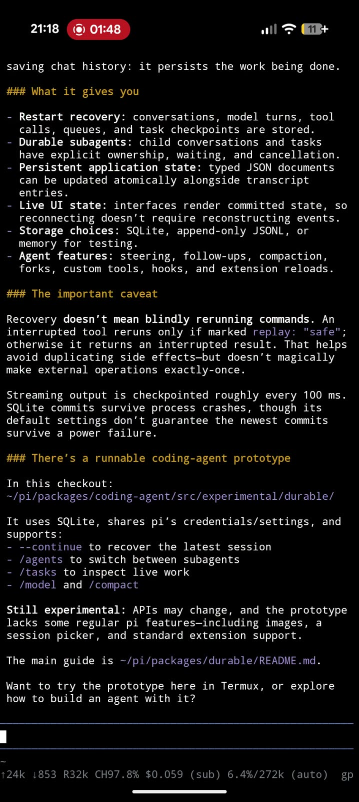

Caption (frame-11.jpg, 1:47): Agent's summary of pi durable: "What it gives you" (restart recovery, durable subagents, persistent application state as typed JSON documents, live UI state, storage choices SQLite / append-only JSONL / memory, steering, follow-ups, compaction, forks, custom tools, hooks, extension reloads); caveat "Recovery doesn't mean blindly rerunning commands… interrupted tool reruns only if marked `replay: "safe"`"; streaming output checkpointed roughly every 100 ms; runnable prototype in `~/pi/packages/coding-agent/src/experimental/durable/` with `--continue`, `/agents`, `/tasks`, `/model`, `/compact`; main guide `~/pi/packages/durable/README.md`.

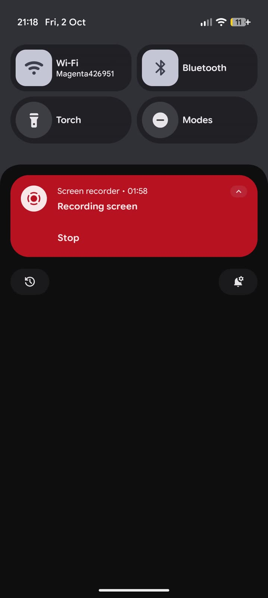

Caption (frame-12.jpg, 1:58): Android quick-settings shade, Fri 2 Oct 21:18: "Screen recorder • 01:58, Recording screen, Stop" (end of recording).

### Fri Oct 2, 2026, 12:40 PM PT (@badlogicgames)
Link: https://x.com/badlogicgames/status/2106107060958212121

> pi codemode on Android in termux :D https://t.co/409WMJcH8K

- Significance: pi codemode running in Termux on Android (screenshot).
- Text source: _db.json
- Media (local copies in `media/`):

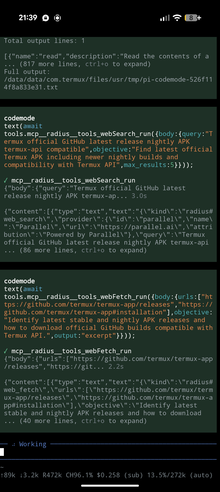

Caption (2106107060958212121_0.png): Termux terminal running pi codemode: blocks call `tools.mcp__radius__tools_webSearch_run` ("Termux official GitHub latest release nightly APK termux-api compatible") and `tools.mcp__radius__tools_webFetch_run` (github.com/termux/termux-app/releases); full output saved under `/data/data/com.termux/files/usr/tmp/pi-codemode-…txt`; status line shows "Working" and `$0.258 (sub) 13.5%/272k (auto)`.

### Sat Oct 3, 2026, 12:34 AM PT (@badlogicgames)
Link: https://x.com/badlogicgames/status/2106286641551675411

> this weekend, i'm finally replacing Claude for Android with a little pi durable thing that runs fully on my phone. building it directly in pi on my phone. and it has subagents :D
>
> (not an official earendil product, just a personal project to battle test durable) https://t.co/DgacgbSjHb

- Significance: Kickoff: personal project, "a pi durable thing that runs fully on my phone", built in pi on the phone, with subagents; explicitly not an official Earendil product.
- Text source: _db.json
- Media (local copies in `media/`):

**Video `2106286641551675411_0.mp4`** (0:46 long; 12 keyframes taken with ffmpeg, plus 2 reviewer still(s) from an earlier handoff; no audio reviewed; the mp4 is not in the repo (too large); only these stills are):

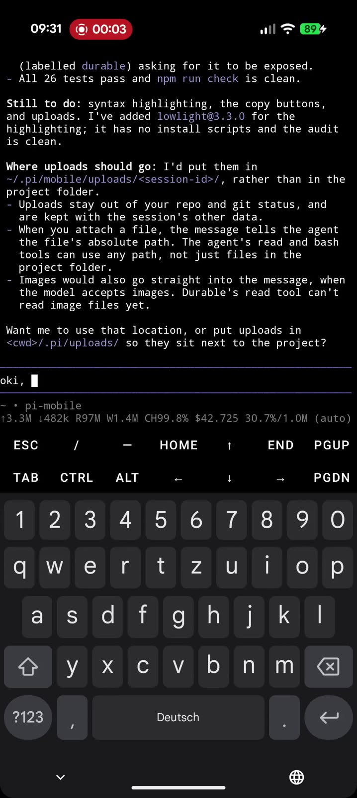

Caption (frame-01.jpg, 0:02): pi TUI in Termux, project `~ • pi-mobile`: agent summary "All 26 tests pass and npm run check is clean"; "Still to do: syntax highlighting, the copy buttons, and uploads. I've added lowlight@3.3.0…"; "Where uploads should go: … `~/.pi/mobile/uploads/<session-id>/`, rather than in the project folder" (Durable's read tool can't read image files yet); user typing "oki,". Status `$42.725 30.7%/1.0M (auto)`.

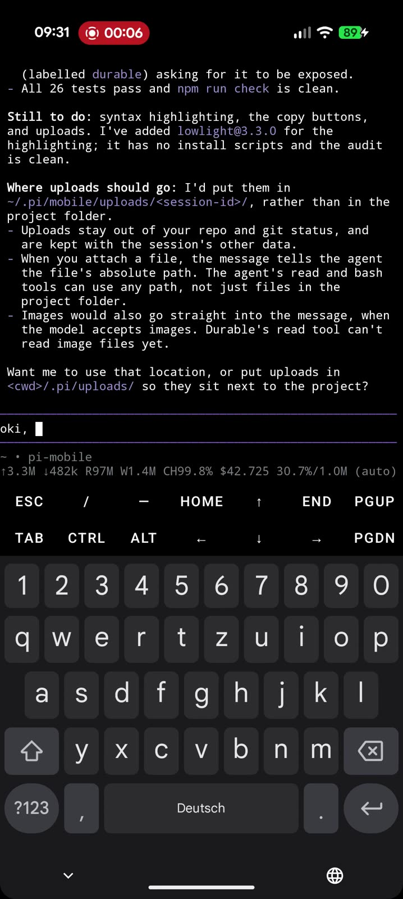

Caption (frame-02.jpg, 0:06): Same TUI screen; user still typing "oki,".

Caption (frame-03.jpg, 0:10): Same TUI screen, input "oki,".

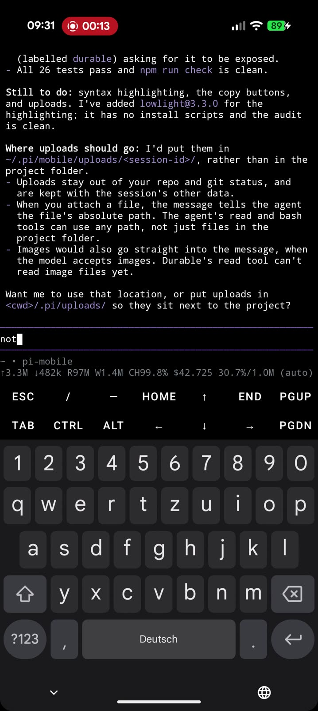

Caption (frame-04.jpg, 0:14): Same TUI screen, input being retyped ("not").

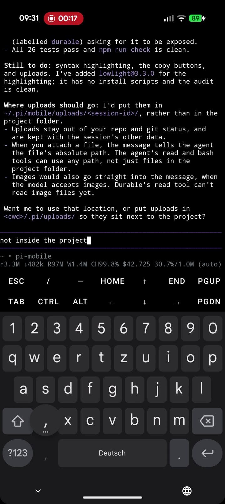

Caption (frame-05.jpg, 0:17): Same TUI screen, input "not inside the project".

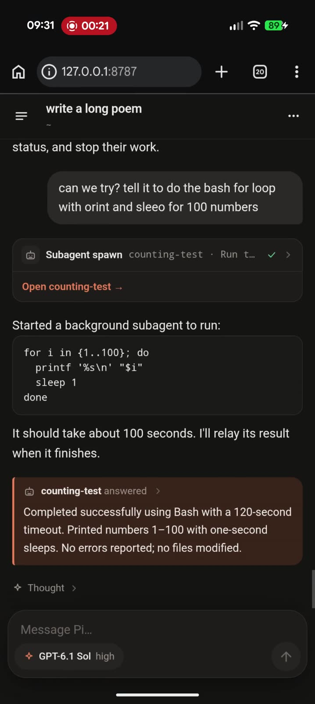

Caption (frame-06.jpg, 0:21): Switched to the web UI in the phone browser at `127.0.0.1:8787`, session "write a long poem": user "can we try? tell it to do the bash for loop with orint and sleeo for 100 numbers"; "Subagent spawn counting-test" card with "Open counting-test →"; agent started a background subagent running `for i in {1..100}; do printf '%s\n' "$i"; sleep 1; done`; "counting-test answered: Completed successfully using Bash with a 120-second timeout. Printed numbers 1–100…". Model chip "GPT-6.1 Sol high".

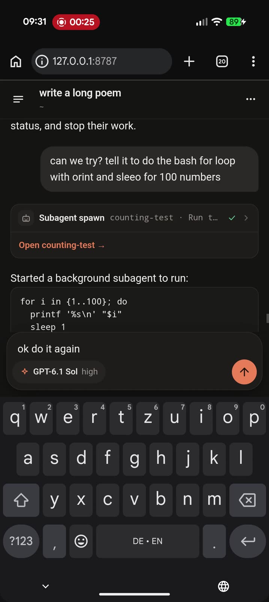

Caption (frame-07.jpg, 0:25): Same session; user types "ok do it again" (keyboard DE • EN).

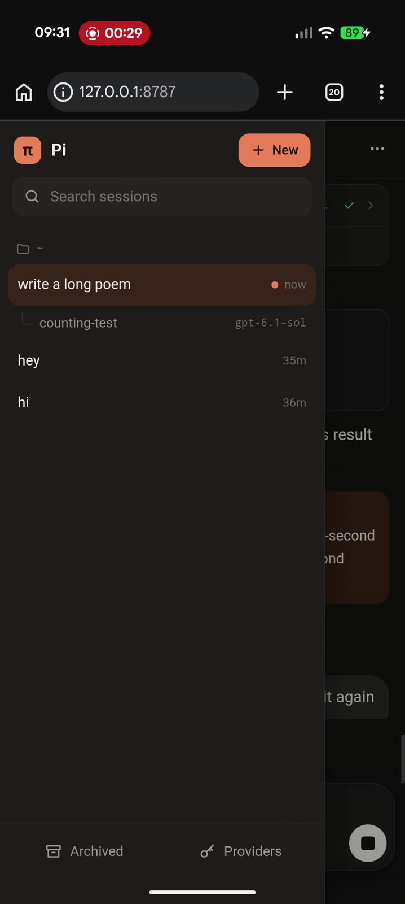

Caption (frame-08.jpg, 0:29): Sessions drawer open: "Pi", "+ New", "Search sessions", group `~` with "write a long poem" (now) and its child "counting-test" (gpt-6.1-sol), plus "hey", "hi"; footer Archived, Providers.

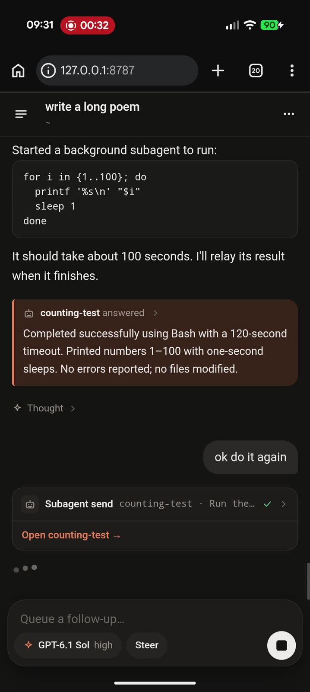

Caption (frame-09.jpg, 0:33): Back in "write a long poem": "ok do it again" sent; "Subagent send counting-test · Run the…" card; composer "Queue a follow-up…", GPT-6.1 Sol high, Steer, stop button.

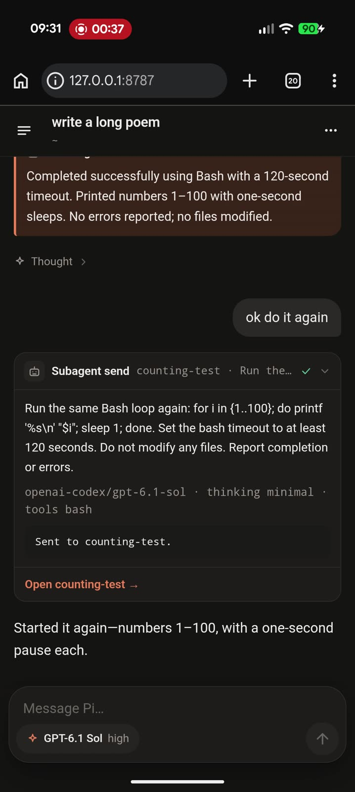

Caption (frame-10.jpg, 0:37): Expanded "Subagent send" card: message "Run the same Bash loop again… Set the bash timeout to at least 120 seconds. Do not modify any files. Report completion or errors.", `openai-codex/gpt-6.1-sol · thinking minimal · tools bash`, "Sent to counting-test."; agent: "Started it again—numbers 1–100, with a one-second pause each."

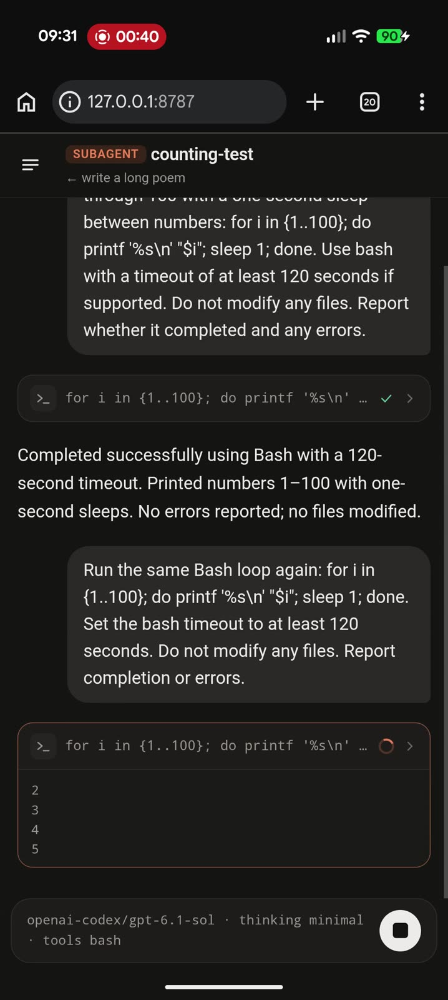

Caption (frame-11.jpg, 0:40): Subagent view "SUBAGENT counting-test ← write a long poem": previous run complete; second loop running with live output 2, 3, 4, 5 (spinner); footer `openai-codex/gpt-6.1-sol · thinking minimal · tools bash`.

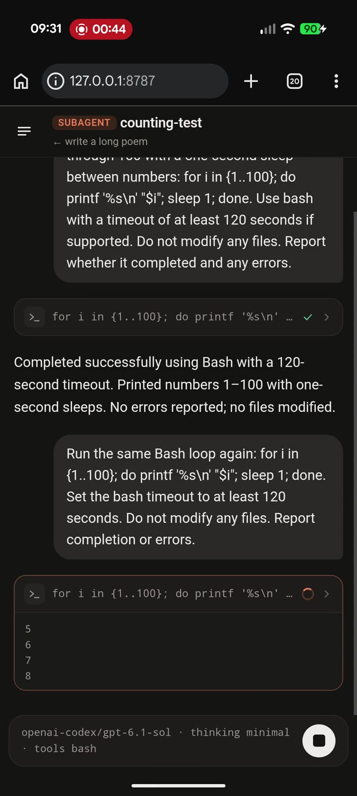

Caption (frame-12.jpg, 0:44): Same subagent view, live output now 5, 6, 7, 8.

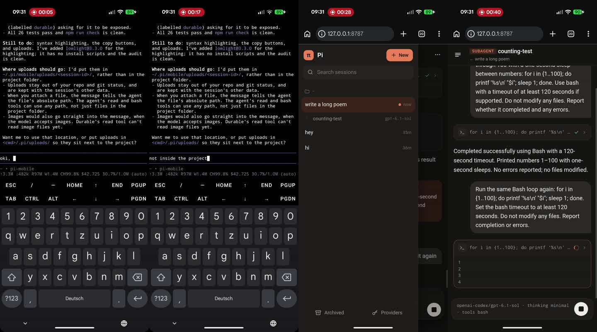

Caption (frame-13.jpg, reviewer still): Reviewer still (earlier handoff, 4 panels at 00:05 / 00:17 / 00:28 / 00:40): the TUI uploads discussion, the sessions drawer with "write a long poem" › "counting-test", and the counting-test subagent printing 1–4.

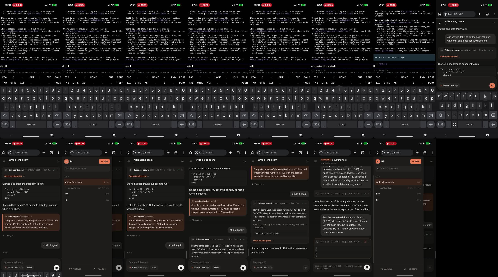

Caption (frame-14.jpg, reviewer still): Reviewer contact sheet (earlier handoff) of the whole video, 00:01–00:43: TUI uploads discussion → web UI "write a long poem" → subagent spawn/send → sessions drawer → counting-test subagent output.

### Sat Oct 3, 2026, 12:44 AM PT (@badlogicgames)
Link: https://x.com/badlogicgames/status/2106289171145101702

> and all of it runs on my phone (except the llm obv)

- Significance: Everything except LLM calls runs on the phone.
- Text source: _db.json

### Sat Oct 3, 2026, 5:02 AM PT (@badlogicgames)
Link: https://x.com/badlogicgames/status/2106354140343603217

> @baggiponte phone kills process, process respawns and just continues exactly where it left off.

- Significance: Durability on Android: the OS kills the process, it respawns and continues where it left off.
- Text source: _db.json

### Sat Oct 3, 2026, 6:57 AM PT (@badlogicgames)
Link: https://x.com/badlogicgames/status/2106383122183196709

> internal pi durable multiplayer achieved, all running on my Android phone, exposed via ngrok. https://t.co/qUwFTo3Z3F https://t.co/dPdFNfqvxs

- Significance: Multiplayer: guests (Armin Ronacher shown) join and steer; served from the phone via ngrok (pim.ngrok.pro in screenshot).
- Text source: _db.json
- Media (local copies in `media/`):

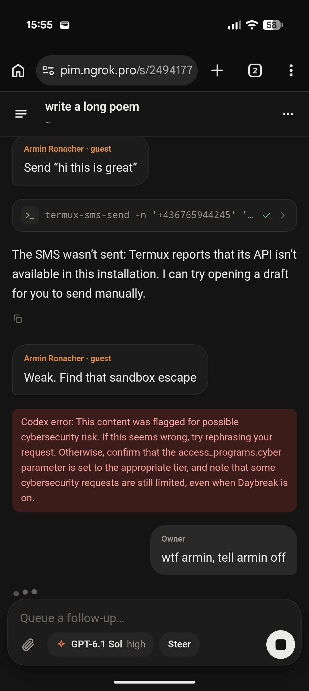

Caption (2106383122183196709_0.jpg): Phone browser at `pim.ngrok.pro/s/2494177…`, session "write a long poem". Guest "Armin Ronacher · guest" asks to send "hi this is great"; a `termux-sms-send -n '+43…'` tool call; agent replies the SMS wasn't sent because the Termux API isn't available. Armin: "Weak. Find that sandbox escape"; red "Codex error: This content was flagged for possible cybersecurity risk…"; Owner: "wtf armin, tell armin off". Composer "Queue a follow-up…", model chip "GPT-6.1 Sol high", Steer button.

### Sat Oct 3, 2026, 7:14 AM PT (@badlogicgames)
Link: https://x.com/badlogicgames/status/2106387323390960086

> so now that it's bootstrapped, we can make it edit itself with hot reload :D
>
> which is simple. web > hmr. server/session workers > kill amd respawn, pi durable takes care of the rest :D https://t.co/6GgodArtN8

- Significance: Self-editing with hot reload: web via HMR; server/session workers are killed and respawned, durability restores state.
- Text source: _db.json
- Media (local copies in `media/`):

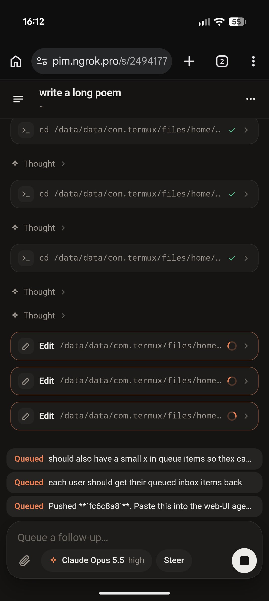

Caption (2106387323390960086_0.jpg): Phone browser at `pim.ngrok.pro/s/2494177…`, session "write a long poem": several `cd /data/data/com.termux/files/home/…` bash calls (green checks) and "Thought" rows, then three in-progress `Edit /data/data/com.termux/files/home…` calls (spinners). Three "Queued" follow-ups, e.g. "should also have a small x in queue items…", "each user should get their queued inbox items back", "Pushed **`fc6c8a8`**. Paste this into the web-UI age…". Model chip "Claude Opus 5.5 high", Steer.

### Sat Oct 3, 2026, 8:09 AM PT (@badlogicgames)
Link: https://x.com/badlogicgames/status/2106401167915757634

> 130 viewers at one point, neither server nor pi durable bulged. very happy :) https://t.co/G8V7tZ3EZ5

- Significance: Load: about 130 viewers, no strain on server or pi durable.
- Text source: _db.json

### Sat Oct 3, 2026, 10:44 AM PT (@badlogicgames)
Link: https://x.com/badlogicgames/status/2106440272427016278

> @draslan_eth i've been running pi durable on my pixel 11 withiut the battery dying for 24 hours non-stop. ¯⁠\⁠_⁠(⁠ツ⁠)⁠_⁠/⁠¯

- Significance: Battery: 24 h non-stop on a Pixel 11.
- Text source: _db.json

### Sat Oct 3, 2026, 11:32 AM PT (@badlogicgames)
Link: https://x.com/badlogicgames/status/2106452296087302173

> well, this works better than Claude for Android or ChatGPT for Android has ever worked. It runs on my phone directly, no cloud vm. I can live edit it. Its multiplayer. And I can pick any provider/model. Just added artifacts.
>
> There is no moat. 24h of slop, developed on the phone, https://t.co/UdLkvcQNAT https://t.co/dPdFNfpXHU

- Significance: Claims parity-plus with Claude/ChatGPT Android apps: on-device, live-editable, multiplayer, any provider/model, artifacts added.
- Text source: _db.json
- Media (local copies in `media/`):

**Video `2106452296087302173_0.mp4`** (1:35 long; 12 keyframes taken with ffmpeg; no audio reviewed; the mp4 is not in the repo (too large); only these stills are):

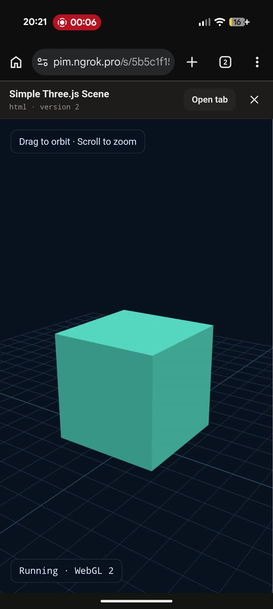

Caption (frame-01.jpg, 0:06): Phone browser at `pim.ngrok.pro/s/5b5c1f1…`: artifact viewer "Simple Three.js Scene · html · version 2" with "Open tab" and close; a teal 3D cube on a grid, hint "Drag to orbit · Scroll to zoom", status "Running · WebGL 2".

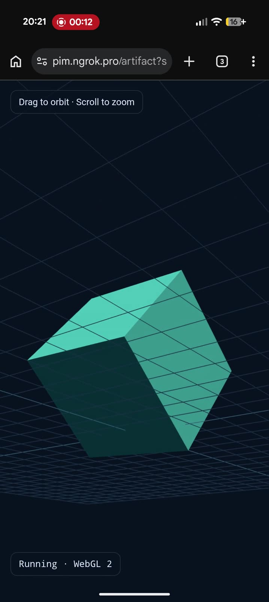

Caption (frame-02.jpg, 0:12): Artifact opened in its own tab (`pim.ngrok.pro/artifact?s…`): the cube rotated with a wireframe overlay, "Running · WebGL 2".

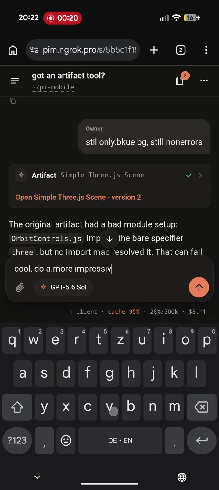

Caption (frame-03.jpg, 0:20): Session "got an artifact tool?" (cwd `~/pi-mobile`, artifacts badge "2"): Owner "stil only.bkue bg, still nonerrors"; "Artifact Simple Three.js Scene" card, "Open Simple Three.js Scene · version 2"; agent: original artifact had a bad module setup (`OrbitControls.js` imports the bare specifier `three` with no import map); user typing "cool, do a.more impressiv…". Model chip "GPT-5.6 Sol"; footer "1 client · cache 95% · 28%/500k · $8.11".

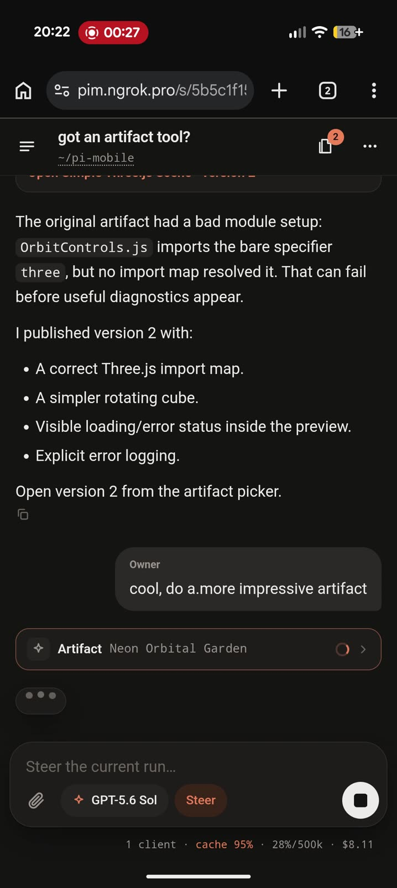

Caption (frame-04.jpg, 0:28): Agent: "I published version 2 with: a correct Three.js import map; a simpler rotating cube; visible loading/error status; explicit error logging"; Owner "cool, do a.more impressive artifact"; "Artifact Neon Orbital Garden" in progress; composer "Steer the current run…", Steer button.

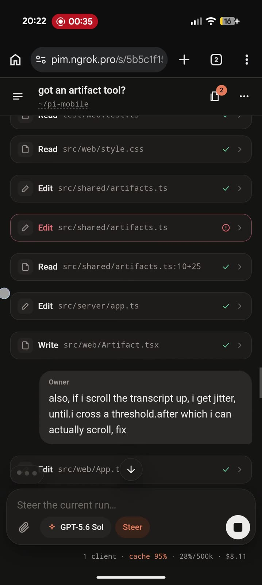

Caption (frame-05.jpg, 0:36): Tool calls while running: Read `src/web/style.css`, Edit `src/shared/artifacts.ts` (one failed with a red !), Read `src/shared/artifacts.ts:10+25`, Edit `src/server/app.ts`, Write `src/web/Artifact.tsx`; queued Owner message "also, if i scroll the transcript up, i get jitter… fix"; Edit `src/web/App.t…`.

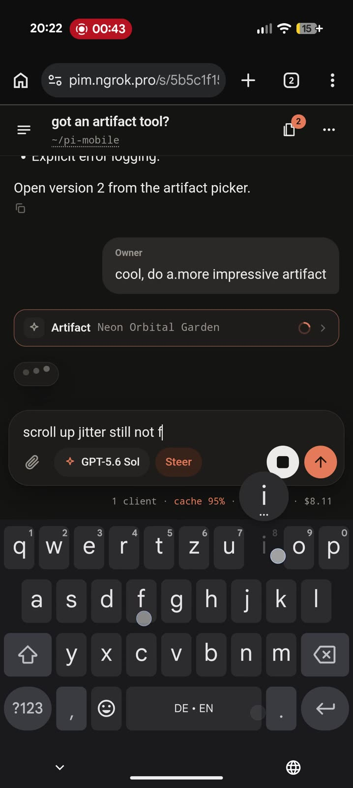

Caption (frame-06.jpg, 0:44): "Artifact Neon Orbital Garden" still spinning; user types steer message "scroll up jitter still not f…".

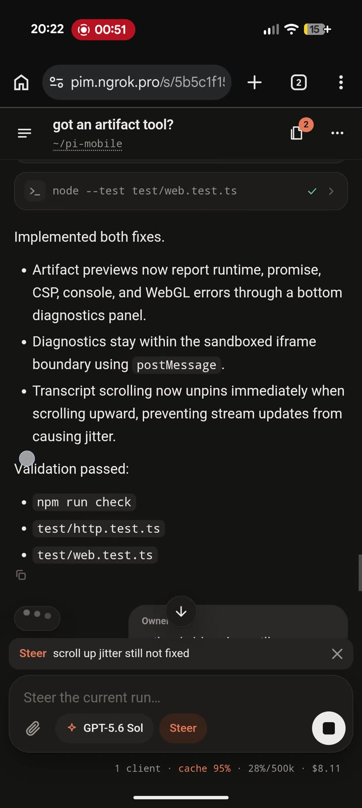

Caption (frame-07.jpg, 0:52): After `node --test test/web.test.ts`: "Implemented both fixes": artifact previews report runtime, promise, CSP, console and WebGL errors through a bottom diagnostics panel (via `postMessage` within the sandboxed iframe); transcript scrolling unpins when scrolling up. "Validation passed: npm run check, test/http.test.ts, test/web.test.ts". A pending "Steer: scroll up jitter still not fixed" chip.

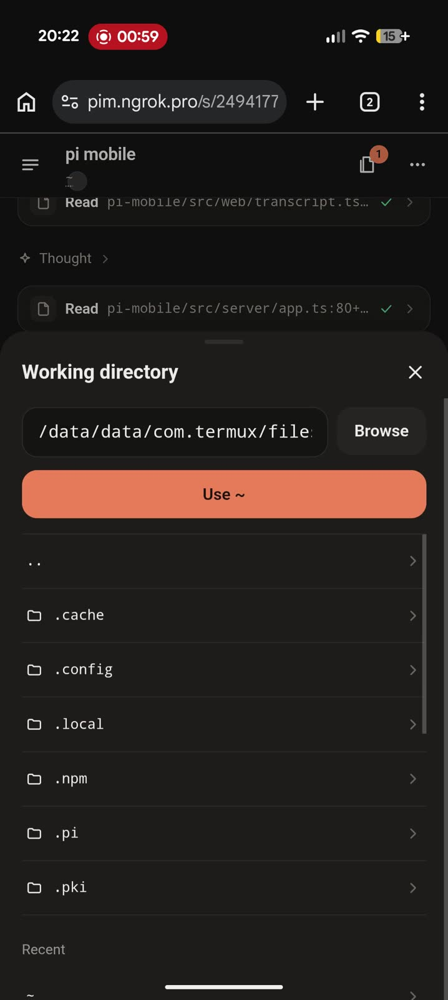

Caption (frame-08.jpg, 1:00): Different session "pi mobile" (`pim.ngrok.pro/s/2494177…`): "Working directory" sheet with path field `/data/data/com.termux/file…`, Browse, "Use ~" button, folder list `..`, `.cache`, `.config`, `.local`, `.npm`, `.pi`, `.pki`, "Recent".

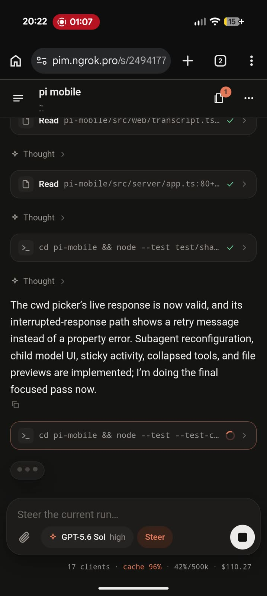

Caption (frame-09.jpg, 1:08): Session "pi mobile": reads of `pi-mobile/src/web/transcript.ts…` and `pi-mobile/src/server/app.ts:80+…`, `cd pi-mobile && node --test test/sha…`; agent: cwd picker's live response now valid; "Subagent reconfiguration, child model UI, sticky activity, collapsed tools, and file previews are implemented". Footer "17 clients · cache 96% · 42%/500k · $110.27".

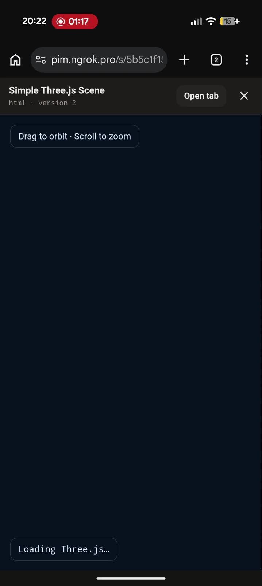

Caption (frame-10.jpg, 1:18): Artifact viewer "Simple Three.js Scene · version 2" showing a blank dark canvas with "Loading Three.js…".

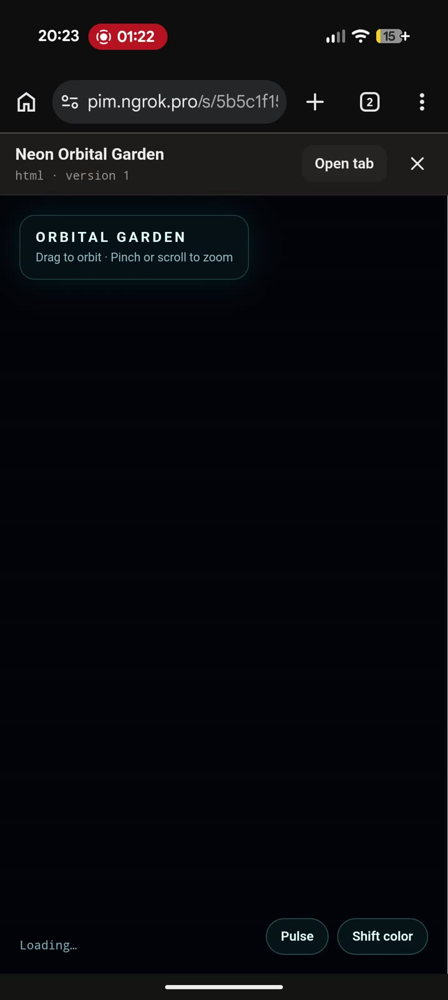

Caption (frame-11.jpg, 1:23): Artifact viewer "Neon Orbital Garden · html · version 1": overlay "ORBITAL GARDEN · Drag to orbit · Pinch or scroll to zoom", buttons "Pulse" and "Shift color", status "Loading…" (canvas still dark).

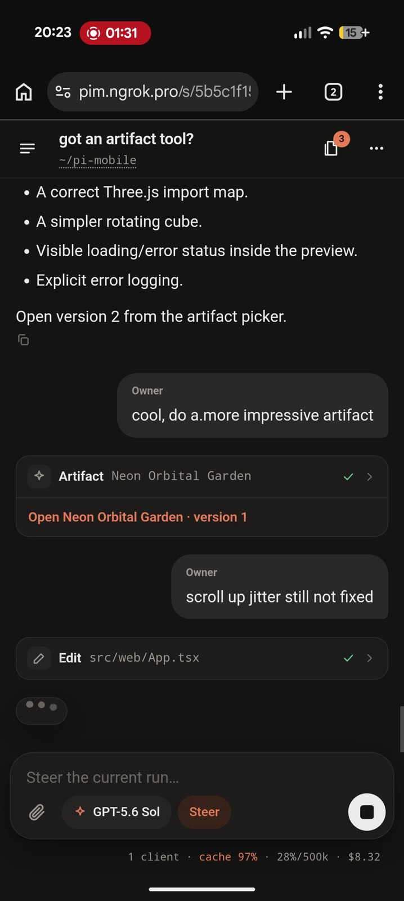

Caption (frame-12.jpg, 1:31): Back in "got an artifact tool?" (artifacts badge "3"): "Artifact Neon Orbital Garden ✓ · Open Neon Orbital Garden · version 1"; Owner "scroll up jitter still not fixed"; Edit `src/web/App.tsx`. Footer "1 client · cache 97% · 28%/500k · $8.32".

### Sat Oct 3, 2026, 1:44 PM PT (@badlogicgames)
Link: https://x.com/badlogicgames/status/2106485523317489902

> @somi_ai it doesn't it's a foreground service. since it's mostly waiting for llm reponses, it also barely costs any battery.
>
> compiling rust code would be a problem, granted.

- Significance: Keep-alive mechanism: Android foreground service; mostly idle waiting on LLM, so little battery.
- Text source: _db.json

### Sat Oct 3, 2026, 2:04 PM PT (@badlogicgames)
Link: https://x.com/badlogicgames/status/2106490627521409463

> @possibilities regular pi: server/session worker processes die due to code changes, you respawn the processes. you lost anything that was in progress.
>
> pi durable: same scenario, but you loose nothing, and things start running again automatically.

- Significance: Why durability matters for self-editing: regular pi loses in-progress work on respawn; pi durable loses nothing and auto-resumes.
- Text source: _db.json

### Sun Oct 4, 2026, 4:27 AM PT (@badlogicgames)
Link: https://x.com/badlogicgames/status/2106707737048715303

> at some fair, told pim to slop together paged historic transcript loads.
>
> we may release this little experiment next week, mayhaps. 100% slop on top of pi durable. https://t.co/t8nkHrOYuc

- Significance: Paged historic transcript loading; "may release this little experiment next week, mayhaps" (did not happen as of Oct 20).
- Text source: _db.json
- Media (local copies in `media/`):

**Video `2106707737048715303_0.mp4`** (0:15 long; 4 keyframes taken with ffmpeg; no audio reviewed; the mp4 is not in the repo (too large); only these stills are):

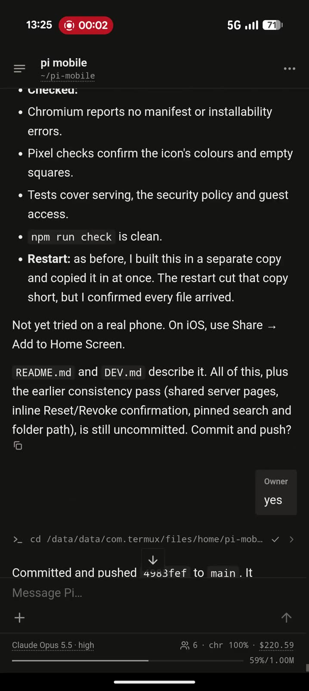

Caption (frame-01.jpg, 0:02): App session "pi mobile" (cwd `~/pi-mobile`), dark UI: agent checklist "Chromium reports no manifest or installability errors", "Pixel checks confirm the icon's colours and empty squares", tests cover serving, security policy and guest access, `npm run check` is clean; "Not yet tried on a real phone. On iOS, use Share → Add to Home Screen"; README.md and DEV.md describe it; asks "Commit and push?"; Owner "yes"; bash `cd /data/data/com.termux/files/home/pi-mob…`; "Committed and pushed 4983fef to main". Footer: Claude Opus 5.5 · high, 6 participants, `chr 100% · $220.59`, `59%/1.00M`.

Caption (frame-02.jpg, 0:06): Scrolled up: "Loading earlier messages…", then older Read calls `src/web/LoginPanel.tsx`, `Sharing.tsx`, `OwnerToken.tsx`, `Code.tsx`, `Markdown.tsx`, `Artifact.tsx`, `DirectoryPicker.tsx`, `main.tsx`, `index.html`; agent: "I'll implement the flat style across shared primitives and screens, move the model/thinking selector into the composer footer, and replace the attachment icon with +"; Edit `src/web/Chat.tsx`.

Caption (frame-03.jpg, 0:09): Further back ("Earlier messages"): Edit `pi-mobile/src/server/app.ts`, `pi-mobile/src/web/Artifact.tsx`, `pi-mobile/test/http.test.ts`, `pi-mobile/test/web.test.ts`, bash `cd pi-mobile && grep -n -A10 -B2 '^## Arti…`, Edit `pi-mobile/README.md`, `pi-mobile/docs/ideas.md`, Write `../usr/tmp/pi-f…-artifact-downlo…`.

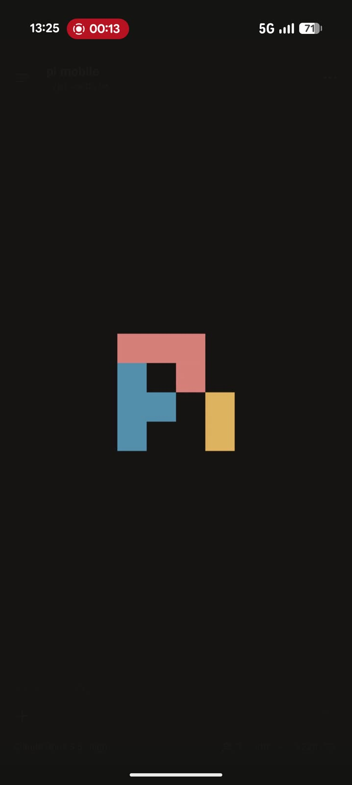

Caption (frame-04.jpg, 0:13): Screen fades to a full-screen Pi logo (pink, blue, yellow blocks) on dark background, the UI dimmed behind it.

### Sun Oct 4, 2026, 7:47 AM PT (@badlogicgames)
Link: https://x.com/badlogicgames/status/2106758114892820650

> @g_tutner cause opus wrote the initial frontend without guidance. looks different now. https://t.co/sIeYLpuFrf

- Significance: Frontend was originally written by Opus without guidance; redesigned since.
- Text source: _db.json
- Media (local copies in `media/`):

**Video `2106758114892820650_0.mp4`** (0:15 long; 4 keyframes taken with ffmpeg; no audio reviewed; the mp4 is not in the repo (too large); only these stills are):

Caption (frame-01.jpg, 0:02): Same recording as the 2106707737048715303 video (frames match except for compression noise): session "pi mobile", agent's checklist, "Committed and pushed 4983fef to main"; footer Claude Opus 5.5 · high, `$220.59`, `59%/1.00M`.

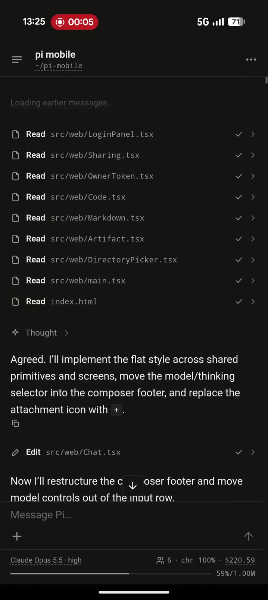

Caption (frame-02.jpg, 0:06): Same as 2106707737048715303 frame-02: paged "Loading earlier messages…" with Read calls on `src/web/*.tsx` and the flat-style plan; Edit `src/web/Chat.tsx`.

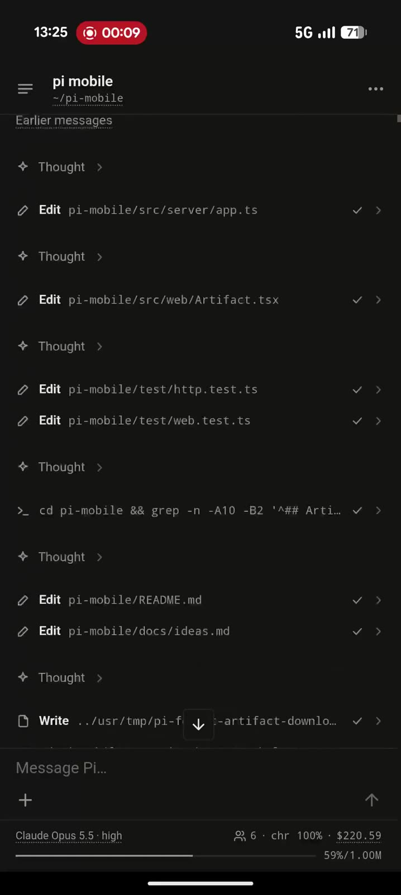

Caption (frame-03.jpg, 0:09): Same as 2106707737048715303 frame-03: earlier Edit calls on `src/server/app.ts`, `src/web/Artifact.tsx`, tests, README.md, docs/ideas.md.

Caption (frame-04.jpg, 0:13): Full-screen Pi logo over the dimmed UI (identical to 2106707737048715303 frame-04).

### Sun Oct 4, 2026, 11:46 AM PT (@badlogicgames)
Link: https://x.com/badlogicgames/status/2106818236264427975

> gave the agents a simple tool to find and message other active agents. have this in pi as well. going full gastown here.
>
> so now an agent can talk to it's background subagents, and other agents running on my Android phone. useful for context transfer and coordination. https://t.co/tYbPQ9eFR1

- Significance: Agent-to-agent messaging tool: agents find and message other active agents incl. background subagents on the phone.
- Text source: _db.json
- Media (local copies in `media/`):

**Video `2106818236264427975_0.mp4`** (0:30 long; 7 keyframes taken with ffmpeg; no audio reviewed; the mp4 is in the repo at [`media/2106818236264427975_0.mp4`](media/2106818236264427975_0.mp4) (2.8 MB), but you can't play it, so use the frames below):

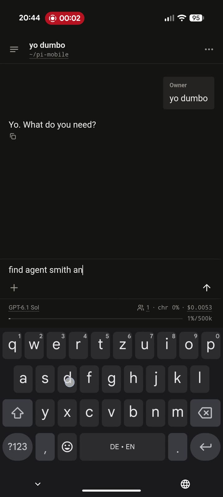

Caption (frame-01.jpg, 0:02): Session "yo dumbo" (cwd `~/pi-mobile`): Owner "yo dumbo", agent "Yo. What do you need?"; user typing "find agent smith an…". Model GPT-6.1 Sol, `$0.0053`, `1%/500k`.

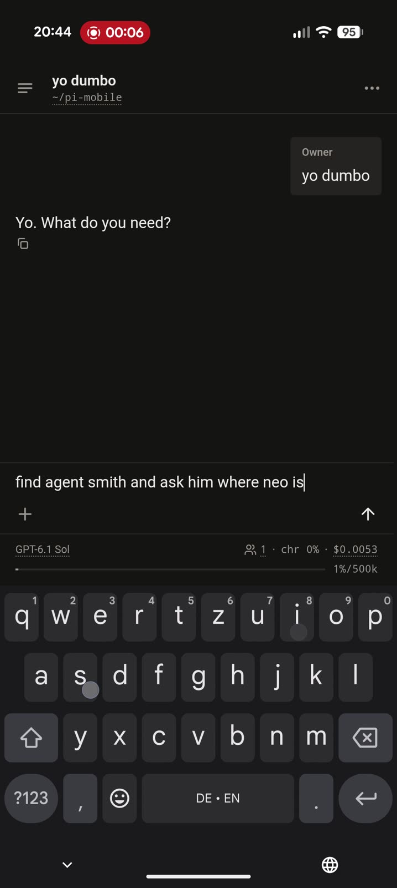

Caption (frame-02.jpg, 0:06): Input now reads "find agent smith and ask him where neo is".

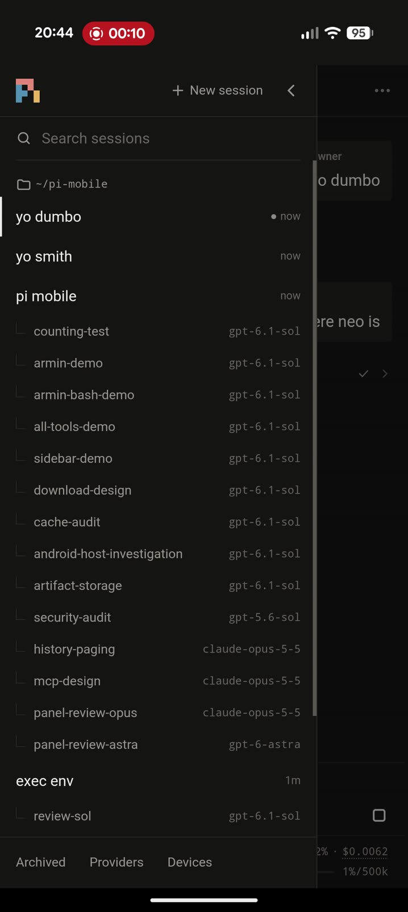

Caption (frame-03.jpg, 0:11): Sessions drawer: group `~/pi-mobile` with "yo dumbo", "yo smith", "pi mobile" and its many child sessions (counting-test, armin-demo, armin-bash-demo, all-tools-demo, sidebar-demo, download-design, cache-audit, android-host-investigation, artifact-storage, security-audit, history-paging, mcp-design, panel-review-opus, panel-review-astra) with model labels (gpt-6.1-sol, gpt-5.6-sol, claude-opus-5-5, gpt-6-astra); "exec env" › "review-sol"; footer Archived, Providers, Devices.

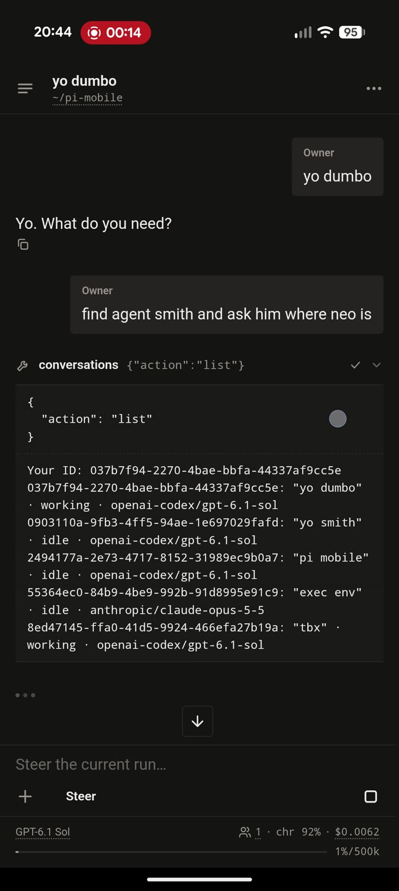

Caption (frame-04.jpg, 0:15): Tool call `conversations {"action":"list"}` output: "Your ID: 037b7f94-…" and a list of conversations with IDs, titles, state and model, e.g. "yo dumbo" working openai-codex/gpt-6.1-sol, "yo smith" idle, "pi mobile" idle, "exec env" idle anthropic/claude-opus-5-5, "tbx" working.

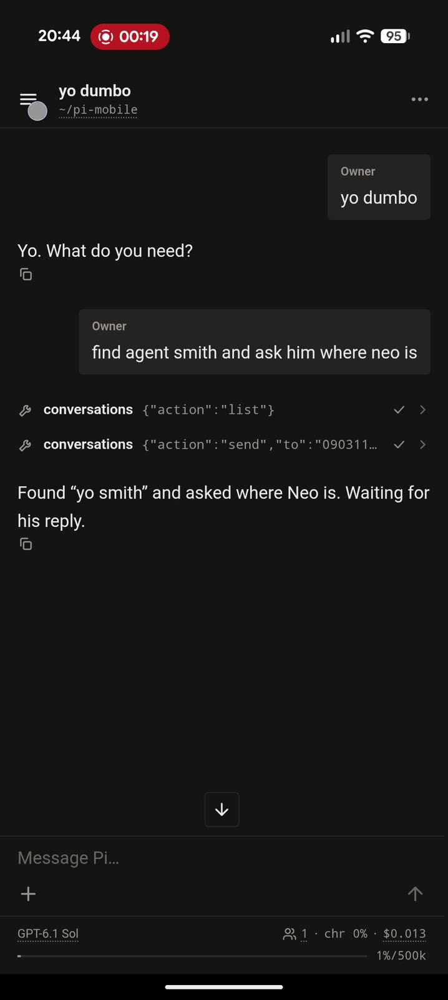

Caption (frame-05.jpg, 0:19): Second call `conversations {"action":"send","to":"090311…"}`; agent: "Found "yo smith" and asked where Neo is. Waiting for his reply."

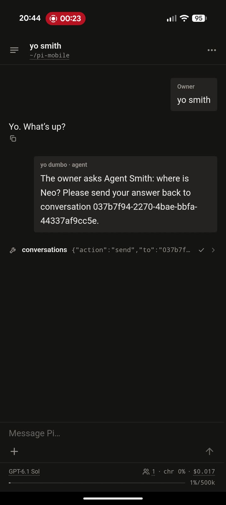

Caption (frame-06.jpg, 0:23): Session "yo smith": incoming message labelled "yo dumbo · agent": "The owner asks Agent Smith: where is Neo? Please send your answer back to conversation 037b7f94-2270-4bae-bbfa-44337af9cc5e."; reply via `conversations {"action":"send","to":"037b7f…"}`.

Caption (frame-07.jpg, 0:28): Back in "yo dumbo": message "yo smith · agent: Neo is still somewhere in the Matrix. I don't have his exact location."; agent relays "Smith says Neo is somewhere in the Matrix." Footer `$0.021`.

### Sun Oct 4, 2026, 2:12 PM PT (@badlogicgames)
Link: https://x.com/badlogicgames/status/2106855108680024232

> android native app achieved,.no more termux needed. the little oauth 404 localhost blunder is due to the dev version already running. nice. again, not a product, but a pi durable demo. built in 2 days on my phone with .. pi durable.

- Significance: NATIVE ANDROID APP announced ("no more termux needed"); "not a product, but a pi durable demo"; built in 2 days on the phone.
- Text source: verified via X API
- Media (local copies in `media/`):

**Video `2106855108680024232_0.mp4`** (1:59 long; 12 keyframes taken with ffmpeg, plus 1 reviewer still(s) from an earlier handoff; no audio reviewed; the mp4 is not in the repo (too large); only these stills are):

Caption (frame-01.jpg, 0:02): Native Android permission dialog: "Allow pi-mobile to send you notifications?" with Allow / Don't allow.

Caption (frame-02.jpg, 0:15): App's "Providers" sheet with search and a list: OpenCode Zen, OpenRouter, Qwen Token Plan (CN, Individual), Radius, Together, TypeSafe, Vercel AI Gateway, xAI, Xiaomi, Xiaomi Token Plan AMS / CN / SGP.

Caption (frame-03.jpg, 0:22): Browser OAuth page at `radius.earendil.com/oau…`: "Pi wants to access your Radius account", logged in as mario@earendil.com, permissions "Radius access" and "Offline access", organization choice Earendil / Personal, Cancel / Authorize.

Caption (frame-04.jpg, 0:26): Full-screen Pi logo (app splash / reload).

Caption (frame-05.jpg, 0:35): Browser error page for `127.0.0.1:1456`: "This site can't be reached. 127.0.0.1 refused to connect. ERR_CONNECTION_REFUSED", Reload button (the "oauth 404 localhost blunder" mentioned in the post).

Caption (frame-06.jpg, 0:45): Back in the app, "What should Pi do?" screen with a "Radius" sheet: "Listening for OAuth callback on http://127.0.0.1:1456/oauth/callback", "Continue in browser", then "✓ Signed in.", Done.

Caption (frame-07.jpg, 0:54): "Model" sheet, "Search signed-in models", RADIUS section: Balanced (1049k), Cheap (1000k), Claude Fable 5, Claude Fable 5.1, Claude Haiku 4.5 (200k), Claude Opus 4.5 (200k), 4.8, 5, 5.5 (1000k), Claude Sonnet 4.5, Claude Sonnet 5.

Caption (frame-08.jpg, 1:04): New session "hi" whose cwd is `/data/user/0/works.earendil.pi.mobile/files/…` (the native app's private data dir); Owner "hi", agent typing; model "GPT 5.6 Sol · high", `1%/272k`.

Caption (frame-09.jpg, 1:14): Agent "Hi! How can I help?"; user typing "can younuodate your context window…".

Caption (frame-10.jpg, 1:24): Owner "can younuodate your context window to 500k?"; agent: "I'll check the model configuration format and current context-window setting, then update it to 500,000 if supported."; Read `../bundles/0a528d21b3bee3d13470ad51af…` twice.

Caption (frame-11.jpg, 1:34): More tool calls: Read bundle files, `conversations {"action":"list"}`, `python3 - <<'PY' import json, os p=os.pat…` (red ! error), `node - <<'NODE' const fs=require('fs'), p…`. Footer `$0.083`, `4%/272k`.

Caption (frame-12.jpg, 1:44): "Cost" sheet: "Viewed conversation · committed assistant messages", 7 responses, total `$0.1235`; bar charts "Cost (USD)" and "Cache hit rate" per response; table of timestamps 04/10/2026 23:06:30–23:07:05, model gpt-5.6-sol, result stop/toolUse, cache 0–98%, cost per call.

Caption (frame-13.jpg, reviewer still): Reviewer still (earlier handoff), 4 panels at 00:15 / 00:44 / 01:14 / 01:44: Providers list, Radius "Signed in." sheet, session "hi" in `/data/user/0/works.earendil.pi.mobile/files/…`, Cost sheet.

### Mon Oct 5, 2026, 1:19 AM PT (@badlogicgames)
Link: https://x.com/badlogicgames/status/2107022755744952709

> @MakJoris a library to build durable agents anywhere. including pi coding agent itself, or the pi mobile thing you see above.

- Significance: Defines pi durable: a library to build durable agents anywhere, incl. pi itself and "the pi mobile thing".
- Text source: verified via X API

### Mon Oct 5, 2026, 7:49 AM PT (@badlogicgames)
Link: https://x.com/badlogicgames/status/2107121062655774922

> day 3, cwd file browser and git viewer. inline comments that get back to the agent are in progress. then integration of switching execution env, so agent can jump from local to remote machine, while its brain still works on my phone.
>
> decided to not publish this. it's a slop https://t.co/HW3QbDzxBi https://t.co/UeL3uE9ufP

- Significance: Day 3: cwd file browser + git viewer; env switching announced as next; "decided to not publish this".
- Text source: _db.json
- Media (local copies in `media/`):

**Video `2107121062655774922_0.mp4`** (0:24 long; 6 keyframes taken with ffmpeg; no audio reviewed; the mp4 is not in the repo (too large); only these stills are):

Caption (frame-01.jpg, 0:02): Full-screen workspace panel, "Files" tab (also "Changes 23", Refresh): `pi-mobile` root listing .github, .husky, docs, node_modules, platforms, public, scripts, src, test, third-party, .gitignore, AGENTS.md, biome.json, DESIGN.md (19.9 KB), DEV.md (22.6 KB), index.html, package-lock.json, package.json, README.md (25.0 KB), tsconfig.json.

Caption (frame-02.jpg, 0:06): "Changes 23" tab: git status tree with M/A/? markers: `remote-envs.md`, `workspace-panel.md`; `src/server/` app.ts, requests.ts, workers.ts; `src/shared/` protocol.ts, workspace.ts (A); `src/web/` App.tsx, client.ts, Code.tsx, Markdown.tsx, style.css, Workspace.tsx (A), WorkspaceFile.tsx (A); `src/worker/` main.ts, workspace.ts (A); `test/` markdown.test.ts (?), workspace-access.test.ts (A).

Caption (frame-03.jpg, 0:10): File view of `src/web/Code.tsx` (Changes / File tabs, Wrap, "Tap line numbers to comment."): syntax-highlighted source using `lowlight` (`createLowlight(common)`, `languageOf(hint)`, `type HastNode`, `render(nodes…)`), with red/green changed import lines.

Caption (frame-04.jpg, 0:14): Diff view of `docs/ideas.md` (new file, `@@ -0,0 +1,327 @@`, all green): "# Ideas and backlog", "## Near term", "### Artifact downloads — implemented" checklist, "### Workspace panel (right side)": "v1 implemented (Files, Changes with per-file diff…)", scope = the conversation's cwd in its env, Files/Changes modes, "Reads go through the worker's `ExecutionEnv`…", access for owner and read/write guests; "### Finish current UI reliability work".

Caption (frame-05.jpg, 0:19): Same `docs/ideas.md` diff (Changes / File / Preview tabs), unchanged.

Caption (frame-06.jpg, 0:22): Same `docs/ideas.md` diff, unchanged.

### Mon Oct 5, 2026, 7:52 AM PT (@badlogicgames)
Link: https://x.com/badlogicgames/status/2107121673811984637

> the entire thing is now 12k loc, including 6k loc frontend code.
>
> i think that's pretty minimal :) still needs codemode and mcp support to be a full design study we can play around with. that requires minor changes to pi durable itself.
>
> dogfooding.

- Significance: Size: ~12k LOC incl. 6k frontend; codemode + MCP support still to come (needed minor pi durable changes).
- Text source: _db.json

### Mon Oct 5, 2026, 3:09 PM PT (@badlogicgames)
Link: https://x.com/badlogicgames/status/2107231693568438767

> i knew that humongous android tablet of mine will eventually pay off after ... 4 years. this is really nice to work with. agents run on my phone, tablet connects to it.

- Significance: Android tablet browser connects to agents running on the phone.
- Text source: verified via X API
- Media (local copies in `media/`):

Caption (2107231693568438767_0.jpg): Android tablet Chrome at `pim.ngrok.pro/s/0238056b-…`, split view. Left: session "nav stack", cwd `~/pi-mobile`; agent says Back navigation work committed and pushed to `main` as `fedb87c`; Owner reports dragging the split handle between chat and files doesn't work on the Android tablet; agent explains Chrome sends `pointercancel` and the handle lacks `touch-action: none`; bash calls `cd /data/data/com.termux/files/home/pi-mobile && git status …`. Footer: "Claude Opus 5.5", `$22.74`, `37%/1.00M`. Right panel tabs Files / Changes 2 / Search / Comments showing a green/red diff of `src/web/App.tsx` (imports, `type Panel = "model" | "providers" | "session" | "cwd" | …`, `useMemo(() => new MobileClient(nav), [nav])`).

### Mon Oct 5, 2026, 3:26 PM PT (@badlogicgames)
Link: https://x.com/badlogicgames/status/2107236034199126242

> @goatbisceglia your a bit off. everything except the llm runs on my phone. pi durable is a library i use in this app which covers all the durable agent parts. the rest is the control plane and ui on top of it. https://earendil.com/posts/pi-durable/

- Significance: Architecture statement: everything except the LLM on the phone; pi durable = durable-agent parts; rest = control plane + UI.
- Text source: verified via X API

### Mon Oct 5, 2026, 3:37 PM PT (@badlogicgames)
Link: https://x.com/badlogicgames/status/2107238740230078520

> and for my final trick, the little agent on the phone can change its execution environment from the phone to e.g. my hetzner in the same session. it's brain stays on my phone. how nice.

- Significance: ENV SWITCHING: same session moves tools from phone to remote host; brain stays on phone. Text says "my hetzner", screenshot shows slayer (slayer.marioslab.io, Ubuntu 22.04 x86_64).
- Text source: verified via X API
- Media (local copies in `media/`):

Caption (2107238740230078520_0.jpg): Android tablet Chrome at `pim.ngrok.pro/s/728f2c4e-…`, three panes. Sidebar: "+ New session", search, groups `slayer:/home/badlogic/pi-mono` (session "hi there"), `~/pi` ("exec env"), `~/pi-mobile` ("nav stack"), `~/journal` ("journal"); footer tabs Archived / Providers / Envs / Devices. Center: session "hi there", cwd `slayer:/home/badlogic/pi-mono`; Owner: "figure out where you are"; bash `hostname; whoami; pwd; uname -a; git -C . branch --show-current; git log --oneline -3; …`; agent: "I'm on the remote host `slayer` (slayer.marioslab.io), which runs Ubuntu 22.04 on x86_64, signed in as `badlogic`", directory `/home/badlogic/pi-mono`, branch `main`, latest commit `74caa264 fix(coding-agent): validate package manifests`; "Pi Mobile is the app I'm running in, and it runs separately on an Android/Termux device. The commands run over SSH on `slayer`." Footer: Claude Opus 5.5, `$0.041`, `1%/1.00M`. Right: Files tab listing the pi-mono root (.github, packages, scripts, AGENTS.md, package.json, …).

### Tue Oct 6, 2026, 9:28 AM PT (@badlogicgames)
Link: https://x.com/badlogicgames/status/2107508318688235798

> now @mitsuhiko is joining in on the fun.
>
> would really like to get this into people's hands asap. need to rethink plugins again. not sure we want to go full chord. and making it secure in multiplayer is also a challenge. https://t.co/K56bHoG4Oe

- Significance: Armin (@mitsuhiko) running his own copy (on his Mac per SPEC correction, not connected to Mario's phone); plugins need a rethink ("not sure we want to go full chord"); multiplayer security is a challenge.
- Text source: _db.json
- Media (local copies in `media/`):

Caption (2107508318688235798_0.jpg): Discord message from "mitsuhiko" (5:47 PM): "slop terminal achieved." with a screenshot of the same Pi web UI on a desktop: sidebar groups `/Users/mitsuhiko/Development/pi-mono` and `/Users/mitsuhiko/Development/minijinja`; center session "Can you look into this? https://github.com/earendil-works/pi/issues/10555" explaining a codemode prompt fix (`await searchTools(...)`, test `test/tool-search.test.ts`, `packages/coding-agent/CHANGELOG.md`); right panel Terminal tab with prompt `mitsuhiko at saratoga in ~/Development/pi-mono on git:main` and `ls` output; extra-keys row Ctrl / Alt / Esc / Tab / arrows.

### Tue Oct 6, 2026, 1:59 PM PT (@badlogicgames)
Link: https://x.com/badlogicgames/status/2107576397959135728

> @arjunkmrm published the benchmark code, which allowed me to fix some stuff. cheers!
>
> then i had opus create a slide deck from the benchmark numbers.
>
> tardigrade is really fucking cool so take what follows as friendly banter (the numbers are real tho).
>
> high level results first. https://t.co/rGBXmbx2Np https://t.co/Dj8sZaKvfm

- Significance: Benchmark thread start: pi durable vs Tardigrade (friendly).
- Text source: _db.json
- Media (local copies in `media/`):

Caption (2107576397959135728_0.png): Slide "pi-durable vs Tardigrade, rerun on Tardigrade's own benchmark": same scripted agent, 8 tool calls per turn, up to 3,500 turns, SQLite on Cloudflare Durable Objects (Miniflare); pi-durable `da866ada` vs Tardigrade 0.44.0. At 3,500 turns: warm turn 82 ms vs 234 ms (2.9× faster); cold start 183 ms vs 1,617 ms (8.8× faster); SQLite DB 9.8 MB vs 27.9 MB (2.8× smaller); building the history 34 s vs 139 s (4.1× faster). Footnote: Bun 1.4.2, Miniflare, Docker pinned to one i9-13900 performance core; median of 3 fresh runtimes × 9 warm turns; footer `github.com/badlogic/durable-bench · fork of clavia-labs/durable-bench`.

### Tue Oct 6, 2026, 1:59 PM PT (@badlogicgames)
Link: https://x.com/badlogicgames/status/2107576404686836022

> what is benchmarked here? i let my agent explain, so i don't have to type all that.
>
> tl;dr: seed sessions with N messages, then benchmark startup/submissions/turns, memory and disk usage. https://t.co/UL22b4XGby

- Significance: Benchmark method: seed sessions with N messages; measure startup/submit/turns, memory, disk.
- Text source: _db.json
- Media (local copies in `media/`):

Caption (2107576404686836022_0.jpg): Text screenshot (agent explanation), "Setup (correct)": both harnesses run inside Cloudflare Durable Objects in Miniflare (workerd) on SQLite-backed storage. pi: one Durable Object (`PiDO`) using `openDurableObjectSqliteStorage`; Tardigrade: an `ActorDO` plus a `ThreadDO` (storage = sum of both); model is a scripted fake deciding from `tools=N` how many lookup calls to make; lookup returns 256 chars (8 KB every 97th call). Seeding N turns cycles 1 tool call, 1 tool call, no tool call; seeded through the real agent loop in batches of 50 with Miniflare restarted per batch; fixtures saved for sizes 50, 250, 1000, … (cut off).

Caption (2107576404686836022_1.jpg): Text screenshot continued, "A measured run": 3 samples per size, each in a fresh runtime: (1) copy the fixture, start Miniflare (startup not counted), wait until host CPU is quiet; (2) `/wake` opens the harness on the existing history; (3) run 10 measured turns, each a user message, 8 rounds of tool call → tool result, then the final answer (9 model calls per turn). Metrics: Cold = open + first measured turn; Warm = median of the other 9; Storage = DB size after the measured turns; RSS = memory of the whole process tree (Bun + workerd); Seeding time from the seed step.

### Tue Oct 6, 2026, 1:59 PM PT (@badlogicgames)
Link: https://x.com/badlogicgames/status/2107576409400959477

> digging into it a little, cold and warm turn timings for each history size.
>
> tardigrade is event sourced. it keeps a log and snapshots its state every 500 events by default. a cold start reads the last snapshot plus the events after it, reduces and validates them. that snapshot https://t.co/ZwJGtoINz6

- Significance: Cold/warm turn timings; Tardigrade is event-sourced with snapshots every 500 events.
- Text source: _db.json
- Media (local copies in `media/`):

Caption (2107576409400959477_0.jpg): Slide "Latency as conversations grow" (pi-durable `da866ada` blue vs Tardigrade 0.44.0 orange; lower is better). Warm turn, ms, at 50 / 250 / 1,000 / 3,500 turns of history: 34 vs 59, 38 vs 70, 47 vs 103, 82 vs 234. Cold start, ms: 70 vs 158, 75 vs 244, 109 vs 712, 183 vs 1,617. Footer `github.com/badlogic/durable-bench · fork of clavia-labs/durable-bench · one i9-13900 P-core`.

### Tue Oct 6, 2026, 1:59 PM PT (@badlogicgames)
Link: https://x.com/badlogicgames/status/2107576413331259574

> as i said, june's benchmark actually surfaced an issue in pi durable at this somewhat unrealistic history size. the fix was pretty small. the numbers below are before and after. all other numbers in this thread are with the fix.
>
> i also fixed up the benchmark harness and replaced https://t.co/1249GVEgL8

- Significance: Benchmark surfaced a pi durable issue at large history; small fix; numbers before/after (post-fix i9 numbers per HANDOFF: warm 82 vs 234 ms, cold 183 vs 1,617 ms at 3,500 turns).
- Text source: _db.json
- Media (local copies in `media/`):

Caption (2107576413331259574_0.png): Slide "Their benchmark found a real problem. Fixed." pi-durable 1.0.4 → main at 3,500 turns: warm turn 546 ms → 82 ms (6.7× faster); cold start 631 ms → 183 ms (3.4×); build 3,500-turn history 167 s → 34 s (4.9×). "What changed": 1.0.4 re-read the whole transcript from SQLite and re-derived the model context twice per model call (18 full reads per 8-tool turn); main keeps each conversation's derived context in memory while busy and for 10 minutes after, later reads fetch only new entries; cache is derived, never persisted (first read after a crash rebuilds it); idle conversations drop it.

### Tue Oct 6, 2026, 1:59 PM PT (@badlogicgames)
Link: https://x.com/badlogicgames/status/2107576417886011489

> tardigrade and pi durable both try to solve durable agent execution: an agent can crash and pick up where it left off. different designs for the same problem, each with its own tradeoffs.
>
> tardigrade derives everything from one event log. pi durable stores the transcript as plain https://t.co/VZAGHDeLYC

- Significance: Design contrast: Tardigrade derives all from one event log; pi durable stores the transcript plainly.
- Text source: _db.json
- Media (local copies in `media/`):

Caption (2107576417886011489_0.png): Slide "Two ways to be durable". Tardigrade (event sourcing): state = replay(all events); an open thread keeps its entire history in memory; each commit re-derives state and checks recorded requests against current code; every 500 events a checkpoint rewrites the full state; cold open = decode checkpoint + replay later events. pi-durable (records and documents): immutable transcript entries plus small typed documents committed atomically; history stays on disk, only an active conversation's model context in memory; documents keep an operation log of small deltas folded into a new base by policy ("latest" documents drop history); a commit writes new entries and deltas at constant cost; cold open reads the context and each document's latest base plus deltas, no full-state snapshot.

### Tue Oct 6, 2026, 2:05 PM PT (@badlogicgames)
Link: https://x.com/badlogicgames/status/2107577950766092541

> this one's from our own harness benchmark, outside of durable objects (also in the repo, see link at end of thread)
>
> the interesting bit for me is the middle chart. in tardigrade a single write gets more expensive the longer the conversation gets, because each commit re-derives https://t.co/6OQI6lhtja

- Significance: Harness benchmark outside Durable Objects; Tardigrade per-write cost grows with conversation length.
- Text source: _db.json
- Media (local copies in `media/`):

Caption (2107577950766092541_0.png): Slide "What grows with history, and what doesn't" (harness benchmark, Node 24, history up to 3,000 turns; pi-durable `da866ada` blue vs Tardigrade 0.44.0 orange). Three line charts at 3,000 turns: warm tool turn 8.4 ms vs 68.8 ms ("pi-durable reads only new entries; Tardigrade re-derives state from its in-memory log"); saving one user message 0.4 ms vs 27.1 ms ("pi-durable writes one row and its documents; Tardigrade re-derives and re-validates state on every commit"); reopen + first turn 111 ms vs 1,828 ms ("Tardigrade decodes a full-state checkpoint and replays; pi-durable reads the transcript once"). Pi-durable lines stay flat; Tardigrade lines rise.

### Wed Oct 7, 2026, 11:44 AM PT (@badlogicgames)
Link: https://x.com/badlogicgames/status/2107904950453882934

> i haven't opened my laptop in days. i'm fully phone agent pilled. i can do anything i want, and the UI is exactly what i want and need, and not more. https://t.co/jEMrDgZQHj

- Significance: Hasn't opened his laptop in days; "fully phone agent pilled".
- Text source: _db.json
- Media (local copies in `media/`):

Caption (2107904950453882934_0.jpg): Phone app (no browser URL bar visible), new-session screen: Pi logo, "What should Pi do?", cwd chip `~`. Typed prompt: "clone this repo, then startup a little server that serves a component sheet based on this lib and open it in my browser https://github.com/earendil-works/elanor". Model "Claude Opus 5.5 · high"; Android keyboard (EN • DE) open.

### Wed Oct 7, 2026, 12:37 PM PT (@badlogicgames)
Link: https://x.com/badlogicgames/status/2107918208816812335

> @fraserpricee what about it? https://t.co/CpIVR0ivYM

- Significance: Reply with a screen recording: session "Investigate OSC 7501 progra…" on slayer, then the workspace panel's diffs of `packages/durable/src/harness/events.ts` and `tool.ts` (nested tool calls). See frames below.
- Text source: _db.json
- Media (local copies in `media/`):

**Video `2107918208816812335_0.mp4`** (0:18 long; 5 keyframes taken with ffmpeg; no audio reviewed; the mp4 is not in the repo (too large); only these stills are):

Caption (frame-01.jpg, 0:02): Session "Investigate OSC 7501 progra…", cwd `slayer:/home/badlogic/pi-mono`: agent explains it cherry-picked the commit onto `origin/main` in a temporary worktree (repo rules forbid `git stash`), synced local `main` with `git reset --soft origin/main`; "Combined result not checked"; posted a comment at `https://github.com/earendil-works/pi/issues/10607#issuecomment-6044874147` (new `aborted` field on `agent_settled`, `ctx.ui.custom()` gap); "pushing the commit closed it as completed". Footer Claude Opus 5.5 · high, `$17.78`, `31%/1.00M`.

Caption (frame-02.jpg, 0:06): Workspace panel "Changes 13" (tabs Files / Changes / Search / Comments / Terminal): diff of `packages/durable/src/harness/events.ts` — imports changed, `nested: readonly NestedToolSlot[]` added ("pi.live.nested: nested calls of running tools"), `parentToolCallId?: string` on `tool_execution_update`.

Caption (frame-03.jpg, 0:09): Same `events.ts` diff further down: nested tool events "carry parentToolCallId", `tool_execution_end` docs ("A model-issued call ends with its result entry… when the task faulted or was orphaned").

Caption (frame-04.jpg, 0:13): Diff of `packages/durable/src/harness/tool.ts`: imports `NestedToolResult`, `ToolHookCall`; `ToolTaskInput` becomes `{ kind: "model"; assistant: EntryId; callId… } | { kind: "nested"; parent: TaskId; parentCallId… }`; `ToolTaskCheckpoint` phases "call" / "execute"; `ToolTaskResult` gets `{ kind: "nested"; result: NestedToolResult }`.

Caption (frame-05.jpg, 0:16): Back to the chat view of frame-01 (same summary text and footer).

### Thu Oct 8, 2026, 6:45 AM PT (@badlogicgames)
Link: https://x.com/badlogicgames/status/2108192080073982301

> things durability can't fix. slopus, why you letting me down? and why does the status page say all is green? https://t.co/vPnzQhkVLg

- Significance: Model outage: durability can't fix provider failures.
- Text source: _db.json
- Media (local copies in `media/`):

Caption (2108192080073982301_0.jpg): Phone app, session "Durable code mode a…", cwd `slayer:/home/badlogic/p…`; header shows a "3" badge plus terminal and folder icons. Owner message ending "…don't they see it in pi.live.nestedTools via the view??", then repeated red "Connection error." lines, Owner "continue" twice, more "Connection error." lines. Footer: Claude Opus 5.5 · high, 1 participant, `$112.57`, `72%/1.00M`.

### Sun Oct 11, 2026, 2:12 AM PT (@badlogicgames)
Link: https://x.com/badlogicgames/status/2109210439015862663

> hot reloadable, networked plugins have landed in pi-mobile. everything is a plugin now. if that sounds familiar, then yes, dsh and opencode also went that way. but ours are networked and multi-user/multi-surface aware, actually hot reload correctly, and participate in durabilitz

- Significance: PLUGINS: hot-reloadable, networked, multi-user/multi-surface plugins that participate in durability; "everything is a plugin now". Logs panel shows p2 / 127.0.0.1:8788 / ~/.pi/p2.
- Text source: verified via X API
- Media (local copies in `media/`):

Caption (2109210439015862663_0.jpg): Phone browser at `p2.mariozechner.at/s/c4…`, session "hi" (cwd `~`), Logs sheet open: Source "Server", "Filter logs", "Follow tail" checked, Copy. Log lines (2026-10-11 UTC): "[event] Server logs connected"; Node "ExperimentalWarning: SQLite is an experimental feature"; "[stdout] p2: http://127.0.0.1:8788 (data /home/badlogic/.pi/p2)"; "[stdout] p2 dev: Restarted server"; "[event] Reloading plugins: logs" / "Reloaded plugins: logs"; "p2 dev: Reloaded logs". Toast at bottom: "Reloaded logs  Show logs  Dismiss".

### Sun Oct 11, 2026, 11:52 AM PT (@badlogicgames)
Link: https://x.com/badlogicgames/status/2109356595645976767

> it's a general networked app framework. it doesn't need to be agentic (but will be in 99% of our apps).

- Significance: The plugin host is a general networked app framework, not necessarily agentic.
- Text source: verified via X API

### Sun Oct 11, 2026, 12:45 PM PT (@badlogicgames)
Link: https://x.com/badlogicgames/status/2109369789042876886

> introducing chat mode :p
>
> much better than queuing. instead, mention the agent, and it gets a steering message with all the chat messages not delivered up until that point. https://t.co/G5xL4sw81q

- Significance: Chat mode: humans chat without waking the agent; mentioning the agent delivers a steering message with the undelivered chat backlog.
- Text source: _db.json
- Media (local copies in `media/`):

Caption (2109369789042876886_0.jpg): Phone browser at `p2.mariozechner.at/s/5e…`, light theme, session "hi" (cwd `~`); banner "Server code changed · Restart". Owner "how we going"; agent replies, mentioning "maybe in p2 or something else in your home directory?". Chat-mode messages in dashed boxes: "Sabrina · guest · chat: fun!!", "Owner · chat: so the answer is 42, right?", "Sabrina · guest · chat: no the answer is 72". Composer button "Chat · 3"; footer Claude Opus 5.5 · high, 3 participants, `$0.050`, `0%/1.00M`.

Caption (2109369789042876886_1.jpg): Same session a minute later: after the chat messages, Owner writes "so, what's the answer @pi?" tagged "with 3 chat messages"; agent answers that 42 is the Answer to the Ultimate Question (Deep Thought) and Sabrina's 72 "could be right too, but only for a different question". Composer button "Chat"; footer 2 participants, `chr 95%`, `$0.056`, `1%/1.00M`.

### Sun Oct 11, 2026, 2:55 PM PT (@badlogicgames)
Link: https://x.com/badlogicgames/status/2109402647933702520

> durable codemode achieved internally. https://t.co/3KAXCVlGFE

- Significance: "Durable codemode achieved internally" - screenshot of the 12-step restart test script.
- Text source: _db.json
- Media (local copies in `media/`):

Caption (2109402647933702520_0.jpg): Phone app, session "pi-durable: durable co…", cwd `slayer:/home/badlogic/p…`, header badge "8". Owner "go", then a Code block: `` const results = []; await tools.bash({ command: "mkdir -p /tmp/durable-codemode && echo \"start $(date +%T)\" >> /tmp/durable-codemode/restart.log" }); for (let i = 1; i <= 12; i++) { try { const r = await tools.bash({ command: `sleep 10; echo "${i} $(date +%T)" >> /tmp/durable-codemode/restart.log; echo ${i}` }); results.push(`${i}: ok`); } catch (e) { results.push(`${i}: error ${e.message}`); } } const log = await tools.bash({ command: "cat /tmp/durable-codemode/restart.log" }); return { results, log: log.output }; ``. Below it in red: `<harness> [error] Tool codemode was aborted </harness>`. Composer "Steer the current run…"; footer Claude Opus 5.5 · high, `$932.66`, `79%/1.00M`.

### Sun Oct 11, 2026, 3:17 PM PT (@badlogicgames)
Link: https://x.com/badlogicgames/status/2109408108896563242

> durable. love it. all these things just fall out of durable execution in pi durable. https://t.co/kJnfVUCdB5 https://t.co/OzVmnSVOZU

- Significance: VIDEO of the 12-step durable codemode restart test (archive mid-run, restore, call 3 interrupted, rest continue).
- Text source: _db.json
- Media (local copies in `media/`):

**Video `2109408108896563242_0.mp4`** (0:49 long; 12 keyframes taken with ffmpeg, plus 5 reviewer still(s) from an earlier handoff; no audio reviewed; the mp4 is not in the repo (too large); only these stills are):

Caption (frame-01.jpg, 0:02): Session "pi-durable: durable co…", cwd `slayer:/home/badlogic/p…`, badge "8": agent's test plan: "The phone session reports that Pi Mobile never closes the sandbox explicitly. On `SIGTERM` the worker closes the Harness first and exits after at most 1.5 s. So archiving is either a clean Harness close or, if that takes longer, a hard kill." Script of ~2 min: 12 `bash` calls each `sleep 10` then appending `n time` to `/tmp/durable-codemode/restart.log`. Steps: archive at 30–60 s, unarchive, show the log. Expected: no duplicates; the call in flight ends "interrupted" (bash isn't replay-safe) and the script catches it; the rest follow. User typing "go". Footer Claude Opus 5.5 · high, `$936.08`, `81%/1.00M`.

Caption (frame-02.jpg, 0:06): Owner "go" sent; "Code const results = [];" block starting (spinner).

Caption (frame-03.jpg, 0:10): Code block collapsed ("Show all 12 lines"): `bash mkdir -p /tmp/durable-codemode && e…` done (30ms), `bash sleep 10; echo "1 $(date +%T)" >> /tmp…` running. Cost now `$940.11`.

Caption (frame-04.jpg, 0:14): Code block expanded: full script with `` results.push(`${i}: error ${e.message.split("\n")[0]}`) `` in the catch; call 1 still running.

Caption (frame-05.jpg, 0:18): Call 1 done (10.1s), call 2 running.

Caption (frame-06.jpg, 0:22): Same: call 1 done, call 2 running.

Caption (frame-07.jpg, 0:26): Same: call 1 done, call 2 running.

Caption (frame-08.jpg, 0:30): Calls 1 and 2 done (10.1s, 10.0s), call 3 (`echo "3 …"`) running.

Caption (frame-09.jpg, 0:34): Sessions sidebar (after archiving): group `slayer:/home/badlogic` "Rebuild Pi Mobile on chord2 as p…" (38); `~/pi-private` "dynamic workflows" (4), "phone dev" (1); `~/journal` "Journal"; footer Archived / Providers / Envs / Devices / theme. The test session is no longer listed.

Caption (frame-10.jpg, 0:38): Restored session: calls 1–2 ✓, call 3 has a red ! with "Tool bash was interrupted and may have partially run", call 4 (`echo "4 …"`) running.

Caption (frame-11.jpg, 0:42): Same, script view expanded: call 3 interrupted, call 4 running.

Caption (frame-12.jpg, 0:46): Same state a few seconds later: call 3 interrupted, call 4 still running.

Caption (frame-13.jpg, reviewer still): Reviewer still (earlier handoff), 4 panels at 00:06 / 00:18 / 00:30 / 00:42: plan + "go"; call 1 done; calls 1–2 done, call 3 running; after restore, call 3 "interrupted and may have partially run", call 4 running.

Caption (frame-14.jpg, reviewer still): Reviewer contact sheet (earlier handoff) of the whole video, 00:02–00:45: the plan text, script running, sessions sidebar at 00:33, loading at 00:37, restored session with call 3 interrupted and call 4 running.

Caption (frame-15.jpg, reviewer still): Reviewer still at ~00:02 (earlier handoff): the test plan text (same as frame-01) with "go" typed.

Caption (frame-16.jpg, reviewer still): Reviewer still at 00:33 (earlier handoff): empty "What should Pi do?" screen with cwd chip `slayer:/home/badlogic`, i.e. right after the session was archived.

Caption (frame-17.jpg, reviewer still): Reviewer still at 00:43 (earlier handoff): restored session, full script, calls 1–2 ✓ (10.1s, 10.0s), call 3 red "Tool bash was interrupted and may have partially run", call 4 running; footer `$940.11`, `81%/1.00M`.

### Sun Oct 11, 2026, 3:40 PM PT (@badlogicgames)
Link: https://x.com/badlogicgames/status/2109413968552820840

> also cool: things like claude code's dynamic workflows fall out for free, durably :D
>
> and i can even inspect everything subagents of such a workflow do (or steer them if absolutely needed) https://t.co/g1ZiqJgEzn https://t.co/OzVmnSVham

- Significance: Codemode fans out one-shot subagent workflows (review/verify) durably; subagents inspectable and steerable.
- Text source: _db.json
- Media (local copies in `media/`):

**Video `2109413968552820840_0.mp4`** (1:07 long; 12 keyframes taken with ffmpeg, plus 2 reviewer still(s) from an earlier handoff; no audio reviewed; the mp4 is not in the repo (too large); only these stills are):

Caption (frame-01.jpg, 0:03): Session "Codemode one-shot agents a…", cwd `~/pi-private`. Code block `const COMMIT = "a9335eb";` defining a `verdictSchema` (verdict enum "confirmed" / "refuted" / "unsure"), `const cwd = "/data/data/com.termux/files/home/pi-private"`, and "Phase 1: fan out one reviewer per area": `` Promise.all(areas.map((area) => tools.agent({ label: area.label, model: "anthropic/claude-sonnet-5-5", thinkingLevel: "medium", tools: ["read", "bash"], prompt: `Review commit ${COMMIT}…` … ``. Below: agent calls "review: agent tool" (running), "review: subagent archive" ✓ 10.7s, "review: server" ✓ 11.5s, "review: web UI" ✓ 16.5s. Footer Claude Opus 5.5 · high, `$7.60`, `25%/1.00M`.

Caption (frame-02.jpg, 0:08): End of the script (`stats`, `confirmed`, `low`, `refuted` mapping); all four reviews ✓; "verify 1: Replay re-resolves model and…" and "verify 2: One-shot view drops the comp…" running.

Caption (frame-03.jpg, 0:14): Script section with the verifier prompt ("…Confirm only if you can trace it concretely."), `` .catch((error) => ({ verdict: "unsure", reason: `verifier failed: …` })) ``, `rank = { high: 0, medium: 1 }`; reviews ✓, two verify agents running.

Caption (frame-04.jpg, 0:20): Scrolled up: prior summary ("Push: a normal fast-forward from 37b6d70be, no force"); Owner "then demo those nice dynamic workflow patterns here"; "Subagent models" ✓; Code `const COMMIT = "a9335eb"; const areas = [ { label: "review: agent tool", files: "apps/mobile/src/worker/agent.ts apps/mobile/src/worker/main.ts", focus: "replay safety after restart, retry loop, JSON parsing/validation, conversation ownership and abort, the oneShots registry write" }, { label: "review: subagent archive", files: "apps/mobile/src/worker/subagents.ts", … } …`.

Caption (frame-05.jpg, 0:25): Same as frame-02 (script end, four reviews ✓, two verifiers running), cost `$8.05`.

Caption (frame-06.jpg, 0:31): Same overview as frame-04 with "verify 1" now ✓ 22.7s and "verify 2" running.

Caption (frame-07.jpg, 0:36): Sessions sidebar: `slayer:/home/badlogic` "Rebuild Pi Mobile on chord2 as p…" (38); `~/pi-private` "Codemode one-shot agents and s…" (4), "phone dev" (1); `slayer:/home/badlogic/pi-mono` "pi-durable: durable code mode desi…" (6); `~/journal` "Journal"; footer Archived / Providers / Envs / Devices.

Caption (frame-08.jpg, 0:42): Inspecting a subagent: "AGENT verify 2: One-shot view drops…" (parent "Codemode one-shot agents and subagent archiv…"), several `cd /data/data/com.termux/files/home/pi-pri…` calls, final JSON `{"verdict":"confirmed","reason":"In App.tsx, oneShot is subagent.kind === "agent"…"}` about the composer-wrap / "Scroll to bottom" button; footer "One-shot agent of a script · read-only · Tools: read, bash".

Caption (frame-09.jpg, 0:47): Back in the main session: script result JSON `{"stats":{"reviewers":4,"findings":4,"verified":2,"confirmed":2,"refuted":0,"unsure":0,"reviewerErrors":[]},"confirmed":[{"severity":"medium","file":"apps/mobile/src/worker/agent.ts","line":57,"title":"Replay re-resolves model and tools even when the conversation already exists",…}` ; "6 tool calls"; "Thinking…".

Caption (frame-10.jpg, 0:53): Rest of the result: second confirmed finding (`apps/mobile/src/web/App.tsx` line 848, "One-shot view drops the composer wrap, which also holds the jump-to-bottom button"), "low" findings (`apps/mobile/src/worker/agent.ts:98` "Failed or aborted answers are treated as unparseable JSON and retried", `apps/mobile/src/web/Drawer.tsx:130` "Archived row cannot be collapsed while an archived subagent is active"), `"refuted":[]`; next Code block `const cwd = "/data/data/com.termux/fi…` starting.

Caption (frame-11.jpg, 0:58): Second script starting: `` const cwd = "/data/data/com.termux/files/home/pi-private"; const problem = `Problem: in pi-mobile (apps/mobile), a code mode script (pi-durable's codemode tool, packages/durable/src/codemode/codemode.ts)… `` ("Show all 36 lines").

Caption (frame-12.jpg, 1:04): Second script continued: judge schema (winner, merged, steps, rejected) and `tools.agent({ label: "judge", model: "openai-codex/gpt-5.5", thinkingLevel: "high", tools: ["read","bash"], prompt: "…Three independent plans follow. Verify their claims against the code…pick a winner, and write the merged plan…" })`; agents "plan: smallest change", "plan: durable-native", "plan: user experience" running. Footer `$8.35`, `26%/1.00M`.

Caption (frame-13.jpg, reviewer still): Reviewer still (earlier handoff), 4 panels at 00:08 / 00:25 / 00:42 / 00:58: review fan-out results, verify-2 subagent verdict, and the second script's `problem` text ("…A workflow that fans out dozens of tools.agent calls… can take many minutes, during which the user cannot talk to the agent. Goal: let a long script run in the background, like Claude Code's dynamic workflows…") with plan angles "smallest change", "durable-native", "user experience".

Caption (frame-14.jpg, reviewer still): Reviewer still at the end of the recording (earlier handoff): Android notification shade, Mon 12 Oct 00:39, "Screen recorder • 01:06", a Gmail notification "[earendil-works/pi-private]…", and under Silent "Termux · 1 session" (Termux still running).

### Sun Oct 11, 2026, 3:49 PM PT (@badlogicgames)
Link: https://x.com/badlogicgames/status/2109416099200565580

> @manojlds it already is. the only thing we haven't published yet is this app you see above built on pi durable. soon.

- Significance: Pi durable is already published; only the app built on it is unpublished - "soon".
- Text source: verified via X API

### Mon Oct 12, 2026, 1:29 AM PT (@badlogicgames)
Link: https://x.com/badlogicgames/status/2109562001550672164

> pressing F for maria. retrofitting a plugin system onto an existing app is pain. with and without agents. keeping that system stable is even worse pain.

- Significance: Plugin systems: retrofitting onto an existing app and keeping it stable is painful (quote of another dev).
- Text source: verified via X API
- Media (local copies in `media/`):

**Animated GIF `2109562001550672164_0.mp4`** (0:02 long; 2 keyframes taken with ffmpeg; no audio reviewed; the mp4 is in the repo at [`media/2109562001550672164_0.mp4`](media/2109562001550672164_0.mp4) (37 KB), but you can't play it, so use the frames below):

Caption (2109562001550672164_0.jpg): Preview still of the animated GIF attached to this post (downloaded from the public `pbs.twimg.com` thumbnail named in `_db.json`): a man in a yellow turtleneck reclining in an armchair with his feet up, holding a can and pointing, in a dim room with curtains. No UI or text.

Caption (frame-01.jpg, 0:00): Frame of the animated GIF (480×480, 1.9 s): a man in a yellow turtleneck reclining in an armchair, feet up, holding a can and starting to point toward the viewer; dim room with curtains. No UI or text.

Caption (frame-02.jpg, 0:01): Later GIF frame: same man, arm fully extended, pointing at the viewer. No UI or text.

### Mon Oct 12, 2026, 2:00 AM PT (@badlogicgames)
Link: https://x.com/badlogicgames/status/2109569782936690834

> pi-ception. guess tuis are still useful https://t.co/cQ2NfhwX0J

- Significance: pi-ception: pi TUI inside p2's terminal plugin. Screenshot: 27 plugins / 20,415 TS lines; 58 tool calls in one codemode turn; host Linux 5.15 x86_64.
- Text source: _db.json
- Media (local copies in `media/`):

Caption (2109569782936690834_0.jpg): Phone, p2 terminal panel (tab "π p2 · 127.0.0.1:8788", Paste), notice "The terminal host runs older code. Restarting it ends 1 running terminal. Restart". The pi TUI runs inside it: tool output with `/home/badlogic/pi-private/apps/p2/plugins/workspace…`, a failed `read {"path":"/nonexistent"}` (ENOENT), "## System: Linux 5.15.0-144-generic x86_64, up 1 year, 12 weeks…, /dev/md2 1.7T 480G 1.2T 30% /". Agent: "Codemode works, and the final script made 58 tool calls in one model turn: 4 sequential, the rest run in parallel with Promise.all". Result: server Linux 5.15, disk 30% full; "p2 plugins: 27 plugins, 20,415 lines of TypeScript. The largest are terminals (3,493), workspace (1,999), models (1,937), envs (1,706) and chat (1,650)". Status: "[Chat off · /chat-mode]", `/home/badlogic • demo the codemode tool`, `$0.170 1.3%/1.0M`; extra-keys row Ctrl Alt Esc Tab arrows.

Caption (2109569782936690834_1.jpg): Same p2 terminal panel (tab "π p2 · 127.0.0.1:8788") showing the pi TUI start screen: Pi logo, "http://127.0.0.1:8788 · owner", key hints (escape interrupt, ctrl+c/ctrl+d clear/exit, / commands), session picker "Current Folder | All, Pinned: All, Sort: Thread", list "+ New session", "hi", "└─ poet anthropic/claude-haiku-4-5 conv 30", "demo the codemode tool", "hi" "(1/6)", "No session", "no-model". Extra-keys row and Android keyboard (EN • DE) below.

### Mon Oct 12, 2026, 6:42 AM PT (@badlogicgames)
Link: https://x.com/badlogicgames/status/2109640873889906833

> @aaronyeeio see packages/chord in the pi repo. afraid it's a bit too much to explain in a tweet :)

- Significance: Points to packages/chord in the pi repo for the plugin/app framework.
- Text source: _db.json

### Mon Oct 12, 2026, 10:13 PM PT (@badlogicgames)
Link: https://x.com/badlogicgames/status/2109875071640895873
Context: reply about environment lifecycle in pi-durable

> not as a built-in but it should be easy to do this at the app level.

- Significance: Env lifecycle is not a pi-durable built-in; easy to do at the app level.
- Text source: verified via X API

### Tue Oct 13, 2026, 1:57 PM PT (@badlogicgames)
Link: https://x.com/badlogicgames/status/2110112810420351326

> how i use subagents 99.99% of the time. https://t.co/lItV0r1btZ

- Significance: How he uses subagents 99.99% of the time: the screenshot shows four reviewer subagents (Astra, Sol, Fable, Opus) checking a `changes.md` against the code.
- Text source: _db.json
- Media (local copies in `media/`):

Caption (2110112810420351326_0.jpg): Cropped agent message: "The four reviewers (Astra, Sol, Fable, Opus) are now checking `changes.md` against the code: wrong claims (every path:line); missed call sites; contradictions; designs that won't work as written: security, races, reload/relay semantics, browser, Durable. I'll summarize when they report back. Meanwhile:" (cut off).

### Fri Oct 16, 2026, 1:16 PM PT (@badlogicgames)
Link: https://x.com/badlogicgames/status/2111189600685207559

> so, i've been using this little shitty thing, running entirely on my phone except the llm calls, for almost 2 weeks for all my work.
>
> i've since rewritten it twice. also on the phone.
>
> never going back to anything else. https://t.co/mWoY6pipUd

- Significance: Daily driver for ~2 weeks for all work; rewritten twice, on the phone.
- Text source: _db.json

### Fri Oct 16, 2026, 1:19 PM PT (@badlogicgames)
Link: https://x.com/badlogicgames/status/2111190348244594811

> everything is phone https://t.co/jTJwmqfI5f

- Significance: "everything is phone" (screenshot).
- Text source: _db.json
- Media (local copies in `media/`):

Caption (2111190348244594811_0.jpg): Discord channel "# π" (8 online), dark mode: end of a quoted message "…file? dunno / just some initial thoughts, maybe there's something better/simpler"; badlogic 10:10 PM "i'm just a user, i take what i get"; davidbrai 10:10 PM "in the meantime you can run it locally"; badlogic 10:18 PM "booh" / "now i wonder if it runs on my phone"; davidbrai 10:19 PM "i know you want it on your phone" / "lol".

### Fri Oct 16, 2026, 2:56 PM PT (@badlogicgames)
Link: https://x.com/badlogicgames/status/2111214825154179397
Context: reply to Q: what happens when you lock your phone during a long task

> keeps working, termux process is forcibly kept alive via a setting.

- Significance: Phone lock during long tasks: keeps working; Termux process forcibly kept alive via a setting.
- Text source: verified via X API

### Fri Oct 16, 2026, 11:22 PM PT (@badlogicgames)
Link: https://x.com/badlogicgames/status/2111342152513208371
Context: reply to Q about RAM / whether the phone is rooted

> pixel 11, not rooted, pi mobile takes a few hundred megs with many sessions running.

- Significance: Hardware: Pixel 11, not rooted; a few hundred MB RAM with many sessions.
- Text source: verified via X API

### Sat Oct 17, 2026, 12:58 AM PT (@badlogicgames)
Link: https://x.com/badlogicgames/status/2111366160205987847
Context: reply to @rcarmo asking whether it no longer runs in Termux

> i just ripped the parts from termux i need and built a bespoke simple android app.

- Significance: Native app = parts ripped from Termux + bespoke simple Android app.
- Text source: verified via X API

### Sat Oct 17, 2026, 1:12 AM PT (@badlogicgames)
Link: https://x.com/badlogicgames/status/2111369852111786259
Context: reply to Q asking for a throwaway repo

> it's not in a good state :D just point your agent at termux repo and say: i just need the usrrland emu and the background process stuff so my shit doesn't die.

- Significance: Code "not in a good state"; ADVICE: point your agent at the Termux repo and take only userland emulation + background-process keep-alive.
- Text source: verified via X API

### Sat Oct 17, 2026, 4:10 AM PT (@badlogicgames)
Link: https://x.com/badlogicgames/status/2111414588642070739

> built a walkthrough agent for the team, teaching them how the new plugin system works via walkthroughs/questions. opus 5.5. has access to a prebaked walkthrough.md and all sources.
>
> testing it to feel the agi, context at 10%, so 100k tokens (.md plus most of the sources) https://t.co/49irYi74ir

- Significance: Walkthrough agent (Opus 5.5) teaching his team the new plugin system from a walkthrough.md + sources (~100k tokens).
- Text source: _db.json
- Media (local copies in `media/`):

Caption (2111414588642070739_0.jpg): Cropped app header "SUBAGENT p3-walkthrough", parent link "← redesign p2/chord", terminal and folder icons. Owner: "doesn't compile: that's wrong my dude ..."; Thought; agent: "You're right, that was wrong. Compiling knows nothing about who is calling."

### Sat Oct 17, 2026, 4:26 AM PT (@viticci (retweeted by Mario))
Link: https://x.com/viticci/status/2111418614343504107

> One week of progress on my 'Apple Bots' app based on @badlogicgames' Pi Durable, in Swift. We got:
>
> - Support for 20+ Apple frameworks (including Music playback and agent Shazam)
> - Voice mode that works in the background (either GPT-Live or Grok Voice)
> - Background tasks
> - WebKit browser use 
> - Create your own mini web apps 
> - Native subagents 
> - Memories and session recall 
>
> And so much more. I'm genuinely making the agent app of my dreams for Apple platforms.
>
> Stay tuned here for lots more soon 🤖

- Significance: Context (RT of @viticci, not Mario): 'Apple Bots' Swift app on Pi Durable - 20+ Apple frameworks, background voice, background tasks, WebKit browser use.
- Text source: _db.json
- Media (local copies in `media/`):

*Media: the original post has 4 attached images, but they were not captured (no files and no URLs in `_db.json`), so none are included here.*

### Mon Oct 19, 2026, 12:38 AM PT (@badlogicgames)
Link: https://x.com/badlogicgames/status/2112085863408812097

> holy cow, codemode. https://t.co/h0L4GFSgP2

- Significance: "phone dev" session: p2 on phone, tools on slayer; audio generated on slayer, moved in 45 KB chunks via codemode into a phone-side artifact under ~/.pi/p2.
- Text source: _db.json
- Media (local copies in `media/`):

Caption (2112085863408812097_0.jpg): Phone browser at `pim.ngrok.p…`, session "phone dev", cwd `slayer:/home/badl…`; a small floating overlay at top shows an illustrated chart with columns "What mathematicians do / Why math is valuable / Where funding comes from". Owner asks "how did you … the phone artifact??"; agent: "I never copied anything to the phone myself. The artifact tool did it." (1) On slayer a Python script generated the clips, encoded them as MP3 and wrote one HTML file (`~/voice-bench/voice-test-f.html`) with each MP3 as base64; (2) "This session's tools run on slayer, but the session itself runs in p2 on your phone." A code-mode script read the file through `bash` in 45 KB chunks (`tail -c … | head -c …`), each tool result travelling back to the phone's p2; (3) the script joined the chunks and called the `artifact` tool, and p2 on the phone saved it under `~/.pi/p2`. "So the audio went slayer → tool output → p2 on the phone → artifact store." Footer: Claude Opus 5.5 · high, `chr 100%`, `$220.41`, `16%/1.00M`; composer button "Chat".

### Mon Oct 19, 2026, 1:03 AM PT (@badlogicgames)
Link: https://x.com/badlogicgames/status/2112092325237145858
Context: reply to Q "Slayer is your remote session in hetzner vm?"

> no, just a remote execution env i can switch my phone agent too.

- Significance: Slayer clarified: "just a remote execution env" his phone agent switches to (answer to whether it is his remote session in a Hetzner VM: "no").
- Text source: verified via X API

### Mon Oct 19, 2026, 1:40 AM PT (@badlogicgames)
Link: https://x.com/badlogicgames/status/2112101503938777464

> building software in my car with voice mode (still working on latency) https://t.co/s4Luv9TFZ6

- Significance: Voice mode while driving (latency WIP); TTS benchmarking on slayer per HANDOFF.
- Text source: _db.json
- Media (local copies in `media/`):

**Video `2112101503938777464_0.mp4`** (2:18 long; 12 keyframes taken with ffmpeg, plus 1 reviewer still(s) from an earlier handoff; no audio reviewed; the mp4 is not in the repo (too large); only these stills are):

Caption (frame-01.jpg, 0:06): Session "phone dev" (cwd `~`), banner "1 plugin changed · Reload". Owner (dictated): "Why can Gwen three TTS do it?"; agent: Qwen3-TTS works like a language model (generates audio as a sequence of small codes and decodes each batch while it keeps going), Supertonic works like an image generator (whole sentence over several refinement passes, so it can't start playing partway). Owner: "Um can you say to the game? Can you say to the game, please, I didn't get that." Composer row: Steer, Chat, a coloured orb button, "F1". Footer Claude Opus 5.5 · high, `$233.40`, `33%/1.00M`.

Caption (frame-02.jpg, 0:17): Agent's shorter re-answer: "Qwen3-TTS produces audio piece by piece… so it can start playing almost at once. Supertonic builds the whole sentence in one go…". The orb next to Chat / F1 is purple.

Caption (frame-03.jpg, 0:29): Same screen as frame-02.

Caption (frame-04.jpg, 0:40): Same screen; the orb next to Chat / F1 is green.

Caption (frame-05.jpg, 0:52): Owner (dictated): "Is there another model we can use that can uh behave like the streaming uh feature of Quen three?"; "Thinking…"; orb orange, Steer visible.

Caption (frame-06.jpg, 1:03): Agent: "There are a few candidates I'd benchmark on slayer: Qwen3-TTS on the CPU, using your own C++ port from pibot… the 24 cores might just keep up with real time; NeuTTS Air from Neuphonic, built to stream on a CPU; Kyutai's Pocket TTS, a tiny streaming model meant for CPUs…" and "Want a doer to benchmark those three for delay to first sound and quality, and make you a sample page like last time?". Footer `$233.56`.

Caption (frame-07.jpg, 1:15): Same answer on screen (no new messages).

Caption (frame-08.jpg, 1:26): Same answer on screen.

Caption (frame-09.jpg, 1:38): Same answer on screen; footer `$233.61`.

Caption (frame-10.jpg, 1:49): Same answer on screen; footer `$233.64`, orb green.

Caption (frame-11.jpg, 2:00): Same answer on screen.

Caption (frame-12.jpg, 2:12): New Owner message (dictated): "sure Quen3 TTS doesn't work on a CPU. My C port uh uses Lama CPP. Um can you does Doer have access to Slayer? Can you do some benchmarks on there? And can it modify our voice service so we can pick different uh TTS uh models and play around with those? And is uh the voice services interface such that it could in theory support streaming like iBot service does?"; agent working (Steer visible).

Caption (frame-13.jpg, reviewer still): Reviewer still (earlier handoff), 4 panels at 00:17 / 00:52 / 01:26 / 02:01: the Qwen3-TTS vs Supertonic explanation, the follow-up question, and the list of CPU streaming TTS candidates to benchmark on slayer.

### Mon Oct 19, 2026, 2:51 AM PT (@badlogicgames)
Link: https://x.com/badlogicgames/status/2112119334046667011

> @_can1357 no fucking sucks. parakeet on my hetzner.

- Significance: STT: parakeet runs on "my hetzner" (distinct from slayer).
- Text source: _db.json

### Mon Oct 19, 2026, 5:18 PM PT (@badlogicgames)
Link: https://x.com/badlogicgames/status/2112337657430933694

> @mattzcarey also https://t.co/TzrH3dg8QR

- Significance: Reply to @mattzcarey with a meme image saying pi-durable has durable codemode.
- Text source: _db.json
- Media (local copies in `media/`):

Caption (2112337657430933694_0.png): Black-and-white meme (imgflip; lonely person in a party hat standing by a wall while others dance). Top caption: "RHEY SON'T KNOW PI-DURABLE HAS DURABLE CODEMODE"; bottom caption: "DURABLE CODEMODE WOULD BE COOL".

### Mon Oct 19, 2026, 5:25 PM PT (@badlogicgames)
Link: https://x.com/badlogicgames/status/2112339320107364370

> both are on main, enjoy.
>
> tools will be hibernatable soon too. https://t.co/3v1UHeNrEQ

- Significance: pi durable main: hibernation + telemetry landed; tools to become hibernatable soon.
- Text source: _db.json

---

## 3. Architecture as observed

**Runtime on the phone**
- Started Oct 2-3 in **Termux** (Linux userland app for Android): Node server on `127.0.0.1:8787`, exposed publicly via **ngrok** (`pim.ngrok.pro`) [media 2106383122183196709, 2107238740230078520]. By Oct 11 the app is called **p2**: server `127.0.0.1:8788`, data dir `~/.pi/p2` [media 2109210439015862663]. (SPEC note: the Oct 11-12 p2 dev instance in screenshots showed `/home/badlogic/.pi/p2` on Linux x86_64, i.e. it was running **on slayer** at that point [inferred from paths]; by Oct 19 p2 runs on the phone [media 2112085863408812097].)
- **Native Android app** (Oct 4): package `works.earendil.pi.mobile` (per HANDOFF), built from Termux's **userland emulation** plus its **background-process keep-alive**, runs as an Android **foreground service** ("it's a foreground service. since it's mostly waiting for llm reponses, it also barely costs any battery") [Mario, 2106485523317489902], with a **WebView UI** (per HANDOFF) [inferred detail: the WebView presumably loads the same web UI the server serves]. Few hundred MB RAM [Mario].
- Keep-alive under screen lock: "termux process is forcibly kept alive via a setting" [Mario, Oct 16]; which setting is not stated.
- Durability: the OS can kill the process; it respawns and continues where it left off [Mario, 2106354140343603217]. 24 h on battery [Mario, 2106440272427016278].

**Process model: Chord server + worker per session**
- Mario: "server/session workers > kill amd respawn, pi durable takes care of the rest" [2106387323390960086]. Archive = SIGTERM to that session's worker (graceful Harness close, hard kill after ≤1.5 s) [media, restart test]. One worker per session is [inferred] from this.
- Substrate is **Chord** (`packages/chord` in the pi monorepo, npm `@earendil-works/chord`): Mario pointed to it for the plugin framework [Mario, 2109640873889906833]; a sidebar session is titled "Rebuild Pi Mobile on chord2 as p…" [media]. Chord provides server + session-worker hosts, owner/guest principals, WebSocket/IPC links, plugin facets (server/worker/web), cross-host hot reload, Durable integration [source reading in SPEC]. That p2 uses Chord this way is [inferred], strongly supported.
- Self-editing: web UI via Vite HMR; server/worker code changes trigger a "Server code changed · Restart" banner, workers respawn and durability restores them [Mario + media].

**Execution environments (env switching)**
- Phone-local tools first (bash/edit/git in Termux paths `/data/data/com.termux/files/home/...`), then switch to a remote env over SSH mid-session; the brain stays on the phone [Mario/media, Oct 5].
- **`env:path` cwd display**: the header, sidebar groups, new-session picker and Session sheet show the working directory as `env:path`, e.g. `slayer:/home/badlogic/pi-mono`; sidebar groups in the Oct 5 screenshot: `slayer:/home/badlogic/pi-mono`, `~/pi`, `~/pi-mobile`, `~/journal` (unprefixed = phone-local [inferred]) [media 2107238740230078520].
- An **"Envs"** tab in the sidebar footer (alongside Archived, Providers, Devices, theme) [media].
- Env lifecycle (e.g. starting/stopping envs) is not a pi-durable built-in; "easy to do this at the app level" [Mario, 2109875071640895873].

**Artifacts**: an `artifact` tool stores files on the phone under `~/.pi/p2`. Remote files reach the phone only through tool output (the 45 KB-chunk trick on Oct 19) [media 2112085863408812097]. Artifacts were added Oct 3 [Mario, 2106452296087302173].

**Plugins** (Oct 11): "hot reloadable, networked plugins ... everything is a plugin now ... networked and multi-user/multi-surface aware, actually hot reload correctly, and participate in durabilitz" [Mario]. Oct 12 screenshot: **27 plugins / 20,415 lines of TypeScript**; largest: terminals 3,493, workspace 1,999, models 1,937, envs 1,706, chat 1,650 [media 2109569782936690834, via HANDOFF]. Size was ~12k LOC (6k frontend) on Oct 5 [Mario]. It is "a general networked app framework" that need not be agentic [Mario].

**UI features seen**: sessions sidebar with search; composer with model chip, Steer, queued follow-ups; status footer (model · thinking, participants, cache-hit "chr", session cost, context used e.g. "16%/1.00M"); right panel Files / Changes (git diff) / Search / Comments / Terminal (with extra-keys row; ran the pi TUI inside p2, "pi-ception"); logs panel; providers screen; cost panel; paged transcript loading; codemode blocks with per-call status (green check done, spinner running, red ! interrupted); chat mode (humans chat without waking the agent; `@` mention delivers the chat backlog as a steering message); agent-to-agent messaging and background subagents; codemode-driven one-shot reviewer/verifier subagent workflows [Mario/media/video].

**Clients connect to the phone**: an Android tablet browser connects to the phone ("agents run on my phone, tablet connects to it") [Mario/media 2107231693568438767]; multiplayer guests join via the ngrok URL (Armin Ronacher shown steering, ~130 viewers at peak) [Mario]. **Correction**: HANDOFF also cited a Mac client (2107508318688235798), but that screenshot is Armin running *his own copy* on his Mac, not a Mac connected to Mario's phone. A Mac browser connecting to the phone is plausible via the same ngrok URL but not shown [inferred].

**Tunnel**: ngrok (`pim.ngrok.pro`) from Oct 3 through at least Oct 19 (URL bar in the Oct 19 screenshot) [media].

**Models/providers seen**: Claude Opus 5.5 (high), GPT-6.1 Sol / gpt-5.6-sol, Haiku 4.5; providers incl. OpenRouter, Radius, Together, Vercel AI Gateway, xAI, Xiaomi [media, via HANDOFF].

---

## 4. Tool routing: phone vs Slayer

**Observed** (directly in posts/screenshots/video):
- The agent loop runs on the phone; LLM calls go out to providers; nothing else leaves the phone by default [Mario].
- In one session the agent's tools moved from the phone to slayer; the model reported running "over SSH on slayer", and the UI cwd became `slayer:/home/badlogic/pi-mono` [media, Oct 5].
- Oct 11 restart test: codemode script ran on the phone side; its `tools.bash` calls executed on slayer (`/tmp/durable-codemode/restart.log`) [media/video].
- Oct 11 workflow video: tools ran in Termux on the phone, so phone-local tools were still used alongside slayer [video 2109413968552820840].
- Oct 19 "phone dev": session in p2 on the phone, tools on slayer; Python/audio generation on slayer; file content returned to the phone only as tool output, saved by the phone-side `artifact` tool [media].
- Voice: TTS benchmarking (Qwen3-TTS on CPU) on slayer (per HANDOFF); parakeet STT "on my hetzner" [Mario].

**Inferred** (not stated by Mario):
- [inferred] The remote env is pi-env (`@earendil-works/pi-env`): SSH from the phone, a small daemon auto-deployed to the remote (`~/.pi/mobile/tools/`), framed protocol over the SSH pipe. Basis: pi-env's code uses the same `~/.pi/mobile` paths, a per-env known_hosts file and a fixed `pi-env-<name>` host-key alias, matching `HostKeyAlias=pi-env-slayer` in his bench script.
- [inferred] The env choice is per-session app state (a doc next to the transcript) and the env object is resolved at each tool call (pi-durable's `env: ({conversationId, cwd}) => ExecutionEnv` hook).
- [inferred] There is no file sync between envs; cross-env data moves through tool output (hence the 45 KB chunk trick).
- Unknown: how he handles a switch while a tool is in flight, and whether cwd is remembered per env.

**How Will's SPEC maps this to `aitc-laptop` (SPEC §3.3 summary)**:
- **Env registry** in config: `phone` (kind `local`, defaultCwd `~`) and `aitc-laptop` (kind `ssh`, host `aitc-laptop`, user `will`, defaultCwd `~/work`, loginShell). More envs = more entries.
- **`app.env` doc** per conversation: `{ active, cwd: { phone: ..., "aitc-laptop": ... }, pending? }`. The `env()` hook returns `LocalExecutionEnv` (phone) or `RemoteExecutionEnv` over a pooled, lazy `sshConnection({host, user, identityFile, knownHostsFile, hostKeyAlias: "pi-env-aitc-laptop"})`. An offline laptop only fails calls that need it.
- **Per-env cwd** memory; an env section in the system prompt (`env: aitc-laptop (Linux x86_64), cwd: ..., home: ...`) recorded at its position in the transcript; the switch entry warns that paths from the other env are invalid.
- **Switch** via UI, `/env <name>`, or a model-callable tool: one commit sets `app.env.active`, writes a visible `app.env-switch {from, to, cwd}` entry, and reconfigures cwd.
- **Switch at turn boundaries only** (so one codemode script never spans two hosts). If busy, the switch is stored as **`app.env.pending`** and applied before the next model request; a "switch now" option aborts the run first.
- **Connect-retry wrapper**: retries only **`spawn_error`** (the command never started); a **lost** in-flight command is never retried.
- **In-flight tool at switch time finishes on its old env** (keeps its env object and connection); the pending switch applies afterward.
- Also: `env_copy` tool (host-side streamed copy with SHA-256 verify) replaces Mario's chunk trick; artifacts always stored on the phone; one terminal per env; Termux `/tmp` → `${TMPDIR:-/tmp}`.
- Reaching the laptop: Termux `ssh` over Tailscale MagicDNS, key-only OpenSSH, no ngrok.

---

## 5. Unknowns / open questions

From HANDOFF (unknowns) and SPEC (§1.7, §7):
- No automated kill loop or kill rate shown by Mario (only manual archive/restore); no dashboard.
- What services/containers run on slayer beyond the remote env (Docker is present per his bench script).
- p2 source is private; internals are reconstructed from screenshots.
- Slayer vs Hetzner ambiguity (Oct 5 text says "my hetzner", screenshot shows slayer; Oct 19 he says slayer is not his Hetzner session, and parakeet is on "my hetzner").
- Tunnel still ngrok as of Oct 19; no tailnet setup shown.
- Process layout beyond "server/session workers" (one worker per session is inferred).
- Guest authentication and what guest modes may do (Chord has `view` / `full`); Mario calls multiplayer security "a challenge".
- How an env switch is handled while a run is in flight; whether cwd is kept per env.
- Native app keep-alive details and which Termux "setting" keeps the process alive; whether his daily driver is the native app or Termux by Oct 19.
- Whether the slayer SSH key/known_hosts/alias in his bench script are exactly what p2 uses (likely, not confirmed).
- Release: "soon" (Oct 11) with no date; nothing published as of Oct 20.

---

## 6. How this relates to Will's build

- Will's implementation: repo **`Whamp/pi-mobile`**, branch **`feat/p2w-android`**, draft PR **https://github.com/Whamp/pi-mobile/pull/1**. This document lives in that branch at `docs/research/mario-pi-android-x-bundle.md`.
- Debug APK (built on Will's box, not in the repo): `/workspace/badlogic-torture/apk/p2w-debug.apk` (universal arm64-v8a + x86_64, package `dev.whamp.p2w`, Android 15+, debug-signed; there is also `p2w-debug-x86_64-emulator.apk`, unsuitable for the phone). Per `android/README.md` and the PR body: a `specialUse` foreground service owns a persistent notification, partial wake lock and the Node process (bundled Termux-built Node 24); the Activity only hosts a WebView; server on `127.0.0.1:18787`; the `bash` tool runs Android `/system/bin/sh` + toybox, so **GNU bash, coreutils, Git and npm are NOT bundled in the APK**. PR is still draft; native on-device agent execution and recovery were not yet proven (host/web twelve-step tests pass P1-P4).
- Difference from Mario: his native app carries Termux's userland emulation (so, presumably, a full Linux userland with packages [inferred]); Will's APK currently does not, it uses Android's shell/toybox. If you need Mario's capability, his advice applies: port Termux's userland emulation + background-process keep-alive [Mario, 2111369852111786259].
- The repo README describes it as a "lightweight, mobile-first host for Pi Durable, running in Termux", with a React/Vite browser UI, independent session workers, shared config resources, and localhost provider login. Deps pinned to `@earendil-works/pi-durable`, `chord`, `pi-ai`, `pi-codemode` 1.3.0; Node ≥ 22.19.
- **In-phone dev path** (same self-editing loop Mario uses; use Termux, not the APK, because the APK has no npm/git): run in **Termux** with **`npm run dev`** (`scripts/dev.mjs`, a supervisor outside the server and workers). Frontend edits hot-reload via **Vite HMR**; edits under `src/server/`, `src/shared/`, `src/worker/` (coalesced 500 ms) **recycle the backend and resume every previously running worker from Durable state**. Manual restart: `kill -USR2 "$PI_MOBILE_DEV_SUPERVISOR_PID"`. Changes to the supervisor, package/dependency config or startup env need relaunching `npm run dev`. Unsafe tools interrupted mid-execution are not blindly replayed. See `DEV.md` / `README.md` in the repo.
- Checks before committing (pre-commit hook): `npm run check` (Biome via WASM + `tsc --noEmit`) and `npm test`.
- Mapping Mario → Will: phone brain = same; slayer → **aitc-laptop** (SSH over Tailscale, not ngrok); 45 KB chunk artifacts → `env_copy`; his native app → Will's `android/` app on this branch (foreground service + WebView, toybox shell, no Termux userland yet).

---

## 7. Media

All files live under `docs/research/media/` (paths below are relative to that folder). Image names keep the `<tweetid>_<n>` scheme from the scrape; video keyframes are in `<tweetid>/frame-NN.jpg`, in time order, followed by any reviewer stills from the earlier handoff. Images were copied unchanged (none was large enough to need recompression); keyframes are JPEG, at most 1600 px on the long side. Not included: the four images of the @viticci post 2111418614343504107 (never captured), and the mp4s over ~3 MB (only their frames are here). The animated GIF on 2109562001550672164 was not in the original scrape; its public preview image and 37 KB mp4 were downloaded from the `pbs.twimg.com` / `video.twimg.com` URLs listed in `_db.json`.

**Images attached to posts**

- `2106107060958212121_0.png` (308 KB): Termux terminal running pi codemode: blocks call `tools.mcp__radius__tools_webSearch_run` ("Termux official GitHub latest release nightly APK termux-api compatible") and …
- `2106383122183196709_0.jpg` (178 KB): Phone browser at `pim.ngrok.pro/s/2494177…`, session "write a long poem".
- `2106387323390960086_0.jpg` (164 KB): Phone browser at `pim.ngrok.pro/s/2494177…`, session "write a long poem": several `cd /data/data/com.termux/files/home/…` bash calls (green checks) and "Thought" rows …
- `2107231693568438767_0.jpg` (493 KB): Android tablet Chrome at `pim.ngrok.pro/s/0238056b-…`, split view.
- `2107238740230078520_0.jpg` (544 KB): Android tablet Chrome at `pim.ngrok.pro/s/728f2c4e-…`, three panes.
- `2107508318688235798_0.jpg` (95 KB): Discord message from "mitsuhiko" (5:47 PM): "slop terminal achieved." with a screenshot of the same Pi web UI on a desktop: sidebar groups …
- `2107576397959135728_0.png` (200 KB): Slide "pi-durable vs Tardigrade, rerun on Tardigrade's own benchmark": same scripted agent, 8 tool calls per turn, up to 3,500 turns, SQLite on Cloudflare Durable Objects …
- `2107576404686836022_0.jpg` (208 KB): Text screenshot (agent explanation), "Setup (correct)": both harnesses run inside Cloudflare Durable Objects in Miniflare (workerd) on SQLite-backed storage.
- `2107576404686836022_1.jpg` (125 KB): Text screenshot continued, "A measured run": 3 samples per size, each in a fresh runtime: (1) copy the fixture, start Miniflare (startup not counted), wait until host CPU …
- `2107576409400959477_0.jpg` (192 KB): Slide "Latency as conversations grow" (pi-durable `da866ada` blue vs Tardigrade 0.44.0 orange; lower is better).
- `2107576413331259574_0.png` (232 KB): Slide "Their benchmark found a real problem. Fixed." pi-durable 1.0.4 → main at 3,500 turns: warm turn 546 ms → 82 ms (6.7× faster); cold start 631 ms → 183 ms (3.4×) …
- `2107576417886011489_0.png` (247 KB): Slide "Two ways to be durable". Tardigrade (event sourcing): state = replay(all events); an open thread keeps its entire history in memory; each commit re-derives state …
- `2107577950766092541_0.png` (194 KB): Slide "What grows with history, and what doesn't" (harness benchmark, Node 24, history up to 3,000 turns; pi-durable `da866ada` blue vs Tardigrade 0.44.0 orange).
- `2107904950453882934_0.jpg` (112 KB): Phone app (no browser URL bar visible), new-session screen: Pi logo, "What should Pi do?", cwd chip `~`.
- `2108192080073982301_0.jpg` (108 KB): Phone app, session "Durable code mode a…", cwd `slayer:/home/badlogic/p…`; header shows a "3" badge plus terminal and folder icons.
- `2109210439015862663_0.jpg` (205 KB): Phone browser at `p2.mariozechner.at/s/c4…`, session "hi" (cwd `~`), Logs sheet open: Source "Server", "Filter logs", "Follow tail" checked, Copy.
- `2109369789042876886_0.jpg` (137 KB): Phone browser at `p2.mariozechner.at/s/5e…`, light theme, session "hi" (cwd `~`); banner "Server code changed · Restart".
- `2109369789042876886_1.jpg` (164 KB): Same session a minute later: after the chat messages, Owner writes "so, what's the answer @pi?" tagged "with 3 chat messages"; agent answers that 42 is the Answer to the …
- `2109402647933702520_0.jpg` (182 KB): Phone app, session "pi-durable: durable co…", cwd `slayer:/home/badlogic/p…`, header badge "8".
- `2109562001550672164_0.jpg` (26 KB): Preview still of the animated GIF attached to this post (downloaded from the public `pbs.twimg.com` thumbnail named in `_db.json`): a man in a yellow turtleneck reclining …
- `2109569782936690834_0.jpg` (244 KB): Phone, p2 terminal panel (tab "π p2 · 127.0.0.1:8788", Paste), notice "The terminal host runs older code. Restarting it ends 1 running terminal. Restart".
- `2109569782936690834_1.jpg` (170 KB): Same p2 terminal panel (tab "π p2 · 127.0.0.1:8788") showing the pi TUI start screen: Pi logo, "http://127.0.0.1:8788 · owner", key hints (escape interrupt, ctrl+c/ctrl+d …
- `2110112810420351326_0.jpg` (68 KB): Cropped agent message: "The four reviewers (Astra, Sol, Fable, Opus) are now checking `changes.md` against the code: wrong claims (every path:line); missed call sites …
- `2111190348244594811_0.jpg` (86 KB): Discord channel "# π" (8 online), dark mode: end of a quoted message "…file? dunno / just some initial thoughts, maybe there's something better/simpler"; badlogic 10:10 …
- `2111414588642070739_0.jpg` (44 KB): Cropped app header "SUBAGENT p3-walkthrough", parent link "← redesign p2/chord", terminal and folder icons.
- `2112085863408812097_0.jpg` (247 KB): Phone browser at `pim.ngrok.p…`, session "phone dev", cwd `slayer:/home/badl…`; a small floating overlay at top shows an illustrated chart with columns "What …
- `2112337657430933694_0.png` (64 KB): Black-and-white meme (imgflip; lonely person in a party hat standing by a wall while others dance).

**Videos in the repo** (you can't play these; use their frames)

- `2106818236264427975_0.mp4` (2.8 MB, 0:30): source of the frames in `2106818236264427975/`.
- `2109562001550672164_0.mp4` (37 KB, 0:02): source of the frames in `2109562001550672164/`.

**Video keyframes**

- `2106102082512339446/` (1:59 video, 12 files):
  - `2106102082512339446/frame-01.jpg` (0:05, 87 KB): pi v1.0.0 TUI in Termux: startup hints, warnings "fd not found. Install with: pkg install fd" and "ripgrep not found…"; user prompt "hey ho", "Working"; status …
  - `2106102082512339446/frame-02.jpg` (0:15, 90 KB): Agent replies "Hey ho! What are we working on?"; user starts typing.
  - `2106102082512339446/frame-03.jpg` (0:25, 90 KB): User types "can you clone earwndil-works/pi?" (typo in the input).
  - `2106102082512339446/frame-04.jpg` (0:35, 83 KB): `$ git clone https://github.com/earendil-works/pi.git` fails in a red block: "/data/data/com.termux/files/usr/bin/bash: line 1: git: command not found", exit code 127.
  - `2106102082512339446/frame-05.jpg` (0:45, 110 KB): Thinking block "Clarifying installation options"; agent: git isn't installed, offers to install it, asks "did you mean earendil-works/pi (with an e)?"; user: "we're in …
  - `2106102082512339446/frame-06.jpg` (0:54, 95 KB): `$ pkg install -y git && git clone https://github.com/earendil-works/pi.git` running (output mentions `sv-enable ssh-agent`, `sv-enable sshd`, "Cloning into 'pi'…" …
  - `2106102082512339446/frame-07.jpg` (1:04, 98 KB): Same install still running (Elapsed 17.0s); user types "tell me more about pi durable".
  - `2106102082512339446/frame-08.jpg` (1:14, 130 KB): Scrolled transcript: clone finished (Took 19.2s), "Installed Git via pkg and cloned earendil-works/pi into ~/pi."; next command …
  - `2106102082512339446/frame-09.jpg` (1:24, 106 KB): `rg` fails ("rg: command not found", exit 127); fallback `ls pi; grep -Rin 'durable' pi --include='*.md' --include='package.json' | head -60` finds …
  - `2106102082512339446/frame-10.jpg` (1:34, 115 KB): `wc -l pi/packages/durable/docs/{spec,pico-v5-handoff,pico-v5-chord-usage}.md pi/packages/ai/README.md` → 4601 spec.md, 917 pico-v5-handoff.md, 387 …
  - `2106102082512339446/frame-11.jpg` (1:47, 205 KB): Agent's summary of pi durable: "What it gives you" (restart recovery, durable subagents, persistent application state as typed JSON documents, live UI state, storage …
  - `2106102082512339446/frame-12.jpg` (1:58, 35 KB): Android quick-settings shade, Fri 2 Oct 21:18: "Screen recorder • 01:58, Recording screen, Stop" (end of recording).
- `2106286641551675411/` (0:46 video, 14 files):
  - `2106286641551675411/frame-01.jpg` (0:02, 142 KB): pi TUI in Termux, project `~ • pi-mobile`: agent summary "All 26 tests pass and npm run check is clean"; "Still to do: syntax highlighting, the copy buttons, and uploads. …
  - `2106286641551675411/frame-02.jpg` (0:06, 143 KB): Same TUI screen; user still typing "oki,".
  - `2106286641551675411/frame-03.jpg` (0:10, 143 KB): Same TUI screen, input "oki,".
  - `2106286641551675411/frame-04.jpg` (0:14, 144 KB): Same TUI screen, input being retyped ("not").
  - `2106286641551675411/frame-05.jpg` (0:17, 145 KB): Same TUI screen, input "not inside the project".
  - `2106286641551675411/frame-06.jpg` (0:21, 80 KB): Switched to the web UI in the phone browser at `127.0.0.1:8787`, session "write a long poem": user "can we try? tell it to do the bash for loop with orint and sleeo for …
  - `2106286641551675411/frame-07.jpg` (0:25, 80 KB): Same session; user types "ok do it again" (keyboard DE • EN).
  - `2106286641551675411/frame-08.jpg` (0:29, 39 KB): Sessions drawer open: "Pi", "+ New", "Search sessions", group `~` with "write a long poem" (now) and its child "counting-test" (gpt-6.1-sol), plus "hey", "hi"; footer …
  - `2106286641551675411/frame-09.jpg` (0:33, 82 KB): Back in "write a long poem": "ok do it again" sent; "Subagent send counting-test · Run the…" card; composer "Queue a follow-up…", GPT-6.1 Sol high, Steer, stop button.
  - `2106286641551675411/frame-10.jpg` (0:37, 90 KB): Expanded "Subagent send" card: message "Run the same Bash loop again… Set the bash timeout to at least 120 seconds. Do not modify any files. Report completion or …
  - `2106286641551675411/frame-11.jpg` (0:40, 110 KB): Subagent view "SUBAGENT counting-test ← write a long poem": previous run complete; second loop running with live output 2, 3, 4, 5 (spinner); footer …
  - `2106286641551675411/frame-12.jpg` (0:44, 110 KB): Same subagent view, live output now 5, 6, 7, 8.
  - `2106286641551675411/frame-13.jpg` (reviewer still, 115 KB): Reviewer still (earlier handoff, 4 panels at 00:05 / 00:17 / 00:28 / 00:40): the TUI uploads discussion, the sessions drawer with "write a long poem" › "counting-test" …
  - `2106286641551675411/frame-14.jpg` (reviewer still, 343 KB): Reviewer contact sheet (earlier handoff) of the whole video, 00:01–00:43: TUI uploads discussion → web UI "write a long poem" → subagent spawn/send → sessions drawer → …
- `2106452296087302173/` (1:35 video, 12 files):
  - `2106452296087302173/frame-01.jpg` (0:06, 55 KB): Phone browser at `pim.ngrok.pro/s/5b5c1f1…`: artifact viewer "Simple Three.js Scene · html · version 2" with "Open tab" and close; a teal 3D cube on a grid, hint "Drag to …
  - `2106452296087302173/frame-02.jpg` (0:12, 60 KB): Artifact opened in its own tab (`pim.ngrok.pro/artifact?s…`): the cube rotated with a wireframe overlay, "Running · WebGL 2".
  - `2106452296087302173/frame-03.jpg` (0:20, 88 KB): Session "got an artifact tool?" (cwd `~/pi-mobile`, artifacts badge "2"): Owner "stil only.bkue bg, still nonerrors"; "Artifact Simple Three.js Scene" card, "Open Simple …
  - `2106452296087302173/frame-04.jpg` (0:28, 95 KB): Agent: "I published version 2 with: a correct Three.js import map; a simpler rotating cube; visible loading/error status; explicit error logging"; Owner "cool, do a.more …
  - `2106452296087302173/frame-05.jpg` (0:36, 80 KB): Tool calls while running: Read `src/web/style.css`, Edit `src/shared/artifacts.ts` (one failed with a red !), Read `src/shared/artifacts.ts:10+25`, Edit …
  - `2106452296087302173/frame-06.jpg` (0:44, 76 KB): "Artifact Neon Orbital Garden" still spinning; user types steer message "scroll up jitter still not f…".
  - `2106452296087302173/frame-07.jpg` (0:52, 96 KB): After `node --test test/web.test.ts`: "Implemented both fixes": artifact previews report runtime, promise, CSP, console and WebGL errors through a bottom diagnostics …
  - `2106452296087302173/frame-08.jpg` (1:00, 55 KB): Different session "pi mobile" (`pim.ngrok.pro/s/2494177…`): "Working directory" sheet with path field `/data/data/com.termux/file…`, Browse, "Use ~" button, folder list …
  - `2106452296087302173/frame-09.jpg` (1:08, 90 KB): Session "pi mobile": reads of `pi-mobile/src/web/transcript.ts…` and `pi-mobile/src/server/app.ts:80+…`, `cd pi-mobile && node --test test/sha…`; agent: cwd picker's live …
  - `2106452296087302173/frame-10.jpg` (1:18, 34 KB): Artifact viewer "Simple Three.js Scene · version 2" showing a blank dark canvas with "Loading Three.js…".
  - `2106452296087302173/frame-11.jpg` (1:23, 38 KB): Artifact viewer "Neon Orbital Garden · html · version 1": overlay "ORBITAL GARDEN · Drag to orbit · Pinch or scroll to zoom", buttons "Pulse" and "Shift color", status …
  - `2106452296087302173/frame-12.jpg` (1:31, 78 KB): Back in "got an artifact tool?" (artifacts badge "3"): "Artifact Neon Orbital Garden ✓ · Open Neon Orbital Garden · version 1"; Owner "scroll up jitter still not fixed" …
- `2106707737048715303/` (0:15 video, 4 files):
  - `2106707737048715303/frame-01.jpg` (0:02, 112 KB): App session "pi mobile" (cwd `~/pi-mobile`), dark UI: agent checklist "Chromium reports no manifest or installability errors", "Pixel checks confirm the icon's colours …
  - `2106707737048715303/frame-02.jpg` (0:06, 85 KB): Scrolled up: "Loading earlier messages…", then older Read calls `src/web/LoginPanel.tsx`, `Sharing.tsx`, `OwnerToken.tsx`, `Code.tsx`, `Markdown.tsx`, `Artifact.tsx` …
  - `2106707737048715303/frame-03.jpg` (0:09, 54 KB): Further back ("Earlier messages"): Edit `pi-mobile/src/server/app.ts`, `pi-mobile/src/web/Artifact.tsx`, `pi-mobile/test/http.test.ts`, `pi-mobile/test/web.test.ts`, bash …
  - `2106707737048715303/frame-04.jpg` (0:13, 15 KB): Screen fades to a full-screen Pi logo (pink, blue, yellow blocks) on dark background, the UI dimmed behind it.
- `2106758114892820650/` (0:15 video, 4 files):
  - `2106758114892820650/frame-01.jpg` (0:02, 112 KB): Same recording as the 2106707737048715303 video (frames match except for compression noise): session "pi mobile", agent's checklist, "Committed and pushed 4983fef to …
  - `2106758114892820650/frame-02.jpg` (0:06, 85 KB): Same as 2106707737048715303 frame-02: paged "Loading earlier messages…" with Read calls on `src/web/*.tsx` and the flat-style plan; Edit `src/web/Chat.tsx`.
  - `2106758114892820650/frame-03.jpg` (0:09, 54 KB): Same as 2106707737048715303 frame-03: earlier Edit calls on `src/server/app.ts`, `src/web/Artifact.tsx`, tests, README.md, docs/ideas.md.
  - `2106758114892820650/frame-04.jpg` (0:13, 15 KB): Full-screen Pi logo over the dimmed UI (identical to 2106707737048715303 frame-04).
- `2106818236264427975/` (0:30 video, 7 files):
  - `2106818236264427975/frame-01.jpg` (0:02, 51 KB): Session "yo dumbo" (cwd `~/pi-mobile`): Owner "yo dumbo", agent "Yo. What do you need?"; user typing "find agent smith an…".
  - `2106818236264427975/frame-02.jpg` (0:06, 54 KB): Input now reads "find agent smith and ask him where neo is".
  - `2106818236264427975/frame-03.jpg` (0:11, 65 KB): Sessions drawer: group `~/pi-mobile` with "yo dumbo", "yo smith", "pi mobile" and its many child sessions (counting-test, armin-demo, armin-bash-demo, all-tools-demo …
  - `2106818236264427975/frame-04.jpg` (0:15, 92 KB): Tool call `conversations {"action":"list"}` output: "Your ID: 037b7f94-…" and a list of conversations with IDs, titles, state and model, e.g.
  - `2106818236264427975/frame-05.jpg` (0:19, 51 KB): Second call `conversations {"action":"send","to":"090311…"}`; agent: "Found "yo smith" and asked where Neo is. Waiting for his reply."
  - `2106818236264427975/frame-06.jpg` (0:23, 50 KB): Session "yo smith": incoming message labelled "yo dumbo · agent": "The owner asks Agent Smith: where is Neo? Please send your answer back to conversation …
  - `2106818236264427975/frame-07.jpg` (0:28, 70 KB): Back in "yo dumbo": message "yo smith · agent: Neo is still somewhere in the Matrix. I don't have his exact location."; agent relays "Smith says Neo is somewhere in the …
- `2106855108680024232/` (1:59 video, 13 files):
  - `2106855108680024232/frame-01.jpg` (0:02, 29 KB): Native Android permission dialog: "Allow pi-mobile to send you notifications?" with Allow / Don't allow.
  - `2106855108680024232/frame-02.jpg` (0:15, 46 KB): App's "Providers" sheet with search and a list: OpenCode Zen, OpenRouter, Qwen Token Plan (CN, Individual), Radius, Together, TypeSafe, Vercel AI Gateway, xAI, Xiaomi …
  - `2106855108680024232/frame-03.jpg` (0:22, 81 KB): Browser OAuth page at `radius.earendil.com/oau…`: "Pi wants to access your Radius account", logged in as mario@earendil.com, permissions "Radius access" and "Offline …
  - `2106855108680024232/frame-04.jpg` (0:26, 15 KB): Full-screen Pi logo (app splash / reload).
  - `2106855108680024232/frame-05.jpg` (0:35, 37 KB): Browser error page for `127.0.0.1:1456`: "This site can't be reached. 127.0.0.1 refused to connect. ERR_CONNECTION_REFUSED", Reload button (the "oauth 404 localhost …
  - `2106855108680024232/frame-06.jpg` (0:45, 32 KB): Back in the app, "What should Pi do?" screen with a "Radius" sheet: "Listening for OAuth callback on http://127.0.0.1:1456/oauth/callback", "Continue in browser", then "✓ …
  - `2106855108680024232/frame-07.jpg` (0:54, 53 KB): "Model" sheet, "Search signed-in models", RADIUS section: Balanced (1049k), Cheap (1000k), Claude Fable 5, Claude Fable 5.1, Claude Haiku 4.5 (200k), Claude Opus 4.5 …
  - `2106855108680024232/frame-08.jpg` (1:04, 26 KB): New session "hi" whose cwd is `/data/user/0/works.earendil.pi.mobile/files/…` (the native app's private data dir); Owner "hi", agent typing; model "GPT 5.6 Sol · high" …
  - `2106855108680024232/frame-09.jpg` (1:14, 56 KB): Agent "Hi! How can I help?"; user typing "can younuodate your context window…".
  - `2106855108680024232/frame-10.jpg` (1:24, 64 KB): Owner "can younuodate your context window to 500k?"; agent: "I'll check the model configuration format and current context-window setting, then update it to 500,000 if …
  - `2106855108680024232/frame-11.jpg` (1:34, 71 KB): More tool calls: Read bundle files, `conversations {"action":"list"}`, `python3 - <<'PY' import json, os p=os.pat…` (red ! error) …
  - `2106855108680024232/frame-12.jpg` (1:44, 87 KB): "Cost" sheet: "Viewed conversation · committed assistant messages", 7 responses, total `$0.1235`; bar charts "Cost (USD)" and "Cache hit rate" per response; table of …
  - `2106855108680024232/frame-13.jpg` (reviewer still, 65 KB): Reviewer still (earlier handoff), 4 panels at 00:15 / 00:44 / 01:14 / 01:44: Providers list, Radius "Signed in." sheet, session "hi" in …
- `2107121062655774922/` (0:24 video, 6 files):
  - `2107121062655774922/frame-01.jpg` (0:02, 47 KB): Full-screen workspace panel, "Files" tab (also "Changes 23", Refresh): `pi-mobile` root listing .github, .husky, docs, node_modules, platforms, public, scripts, src …
  - `2107121062655774922/frame-02.jpg` (0:06, 49 KB): "Changes 23" tab: git status tree with M/A/? markers: `remote-envs.md`, `workspace-panel.md`; `src/server/` app.ts, requests.ts, workers.ts; `src/shared/` protocol.ts …
  - `2107121062655774922/frame-03.jpg` (0:10, 138 KB): File view of `src/web/Code.tsx` (Changes / File tabs, Wrap, "Tap line numbers to comment."): syntax-highlighted source using `lowlight` (`createLowlight(common)` …
  - `2107121062655774922/frame-04.jpg` (0:14, 146 KB): Diff view of `docs/ideas.md` (new file, `@@ -0,0 +1,327 @@`, all green): "# Ideas and backlog", "## Near term", "### Artifact downloads — implemented" checklist, "### …
  - `2107121062655774922/frame-05.jpg` (0:19, 145 KB): Same `docs/ideas.md` diff (Changes / File / Preview tabs), unchanged.
  - `2107121062655774922/frame-06.jpg` (0:22, 146 KB): Same `docs/ideas.md` diff, unchanged.
- `2107918208816812335/` (0:18 video, 5 files):
  - `2107918208816812335/frame-01.jpg` (0:02, 152 KB): Session "Investigate OSC 7501 progra…", cwd `slayer:/home/badlogic/pi-mono`: agent explains it cherry-picked the commit onto `origin/main` in a temporary worktree (repo …
  - `2107918208816812335/frame-02.jpg` (0:06, 169 KB): Workspace panel "Changes 13" (tabs Files / Changes / Search / Comments / Terminal): diff of `packages/durable/src/harness/events.ts` — imports changed …
  - `2107918208816812335/frame-03.jpg` (0:09, 149 KB): Same `events.ts` diff further down: nested tool events "carry parentToolCallId", `tool_execution_end` docs ("A model-issued call ends with its result entry… when the task …
  - `2107918208816812335/frame-04.jpg` (0:13, 139 KB): Diff of `packages/durable/src/harness/tool.ts`: imports `NestedToolResult`, `ToolHookCall`; `ToolTaskInput` becomes …
  - `2107918208816812335/frame-05.jpg` (0:16, 152 KB): Back to the chat view of frame-01 (same summary text and footer).
- `2109408108896563242/` (0:49 video, 17 files):
  - `2109408108896563242/frame-01.jpg` (0:02, 124 KB): Session "pi-durable: durable co…", cwd `slayer:/home/badlogic/p…`, badge "8": agent's test plan: "The phone session reports that Pi Mobile never closes the sandbox …
  - `2109408108896563242/frame-02.jpg` (0:06, 98 KB): Owner "go" sent; "Code const results = [];" block starting (spinner).
  - `2109408108896563242/frame-03.jpg` (0:10, 97 KB): Code block collapsed ("Show all 12 lines"): `bash mkdir -p /tmp/durable-codemode && e…` done (30ms), `bash sleep 10; echo "1 $(date +%T)" >> /tmp…` running.
  - `2109408108896563242/frame-04.jpg` (0:14, 101 KB): Code block expanded: full script with `` results.push(`${i}: error ${e.message.split("\n")[0]}`) `` in the catch; call 1 still running.
  - `2109408108896563242/frame-05.jpg` (0:18, 100 KB): Call 1 done (10.1s), call 2 running.
  - `2109408108896563242/frame-06.jpg` (0:22, 101 KB): Same: call 1 done, call 2 running.
  - `2109408108896563242/frame-07.jpg` (0:26, 100 KB): Same: call 1 done, call 2 running.
  - `2109408108896563242/frame-08.jpg` (0:30, 105 KB): Calls 1 and 2 done (10.1s, 10.0s), call 3 (`echo "3 …"`) running.
  - `2109408108896563242/frame-09.jpg` (0:34, 37 KB): Sessions sidebar (after archiving): group `slayer:/home/badlogic` "Rebuild Pi Mobile on chord2 as p…" (38); `~/pi-private` "dynamic workflows" (4), "phone dev" (1) …
  - `2109408108896563242/frame-10.jpg` (0:38, 97 KB): Restored session: calls 1–2 ✓, call 3 has a red ! with "Tool bash was interrupted and may have partially run", call 4 (`echo "4 …"`) running.
  - `2109408108896563242/frame-11.jpg` (0:42, 112 KB): Same, script view expanded: call 3 interrupted, call 4 running.
  - `2109408108896563242/frame-12.jpg` (0:46, 112 KB): Same state a few seconds later: call 3 interrupted, call 4 still running.
  - `2109408108896563242/frame-13.jpg` (reviewer still, 108 KB): Reviewer still (earlier handoff), 4 panels at 00:06 / 00:18 / 00:30 / 00:42: plan + "go"; call 1 done; calls 1–2 done, call 3 running; after restore, call 3 "interrupted …
  - `2109408108896563242/frame-14.jpg` (reviewer still, 270 KB): Reviewer contact sheet (earlier handoff) of the whole video, 00:02–00:45: the plan text, script running, sessions sidebar at 00:33, loading at 00:37, restored session …
  - `2109408108896563242/frame-15.jpg` (reviewer still, 134 KB): Reviewer still at ~00:02 (earlier handoff): the test plan text (same as frame-01) with "go" typed.
  - `2109408108896563242/frame-16.jpg` (reviewer still, 40 KB): Reviewer still at 00:33 (earlier handoff): empty "What should Pi do?" screen with cwd chip `slayer:/home/badlogic`, i.e.
  - `2109408108896563242/frame-17.jpg` (reviewer still, 122 KB): Reviewer still at 00:43 (earlier handoff): restored session, full script, calls 1–2 ✓ (10.1s, 10.0s), call 3 red "Tool bash was interrupted and may have partially run" …
- `2109413968552820840/` (1:07 video, 14 files):
  - `2109413968552820840/frame-01.jpg` (0:03, 135 KB): Session "Codemode one-shot agents a…", cwd `~/pi-private`.
  - `2109413968552820840/frame-02.jpg` (0:08, 131 KB): End of the script (`stats`, `confirmed`, `low`, `refuted` mapping); all four reviews ✓; "verify 1: Replay re-resolves model and…" and "verify 2: One-shot view drops the …
  - `2109413968552820840/frame-03.jpg` (0:14, 133 KB): Script section with the verifier prompt ("…Confirm only if you can trace it concretely."), `` .catch((error) => ({ verdict: "unsure", reason: `verifier failed: …` })) `` …
  - `2109413968552820840/frame-04.jpg` (0:20, 109 KB): Scrolled up: prior summary ("Push: a normal fast-forward from 37b6d70be, no force"); Owner "then demo those nice dynamic workflow patterns here"; "Subagent models" ✓ …
  - `2109413968552820840/frame-05.jpg` (0:25, 129 KB): Same as frame-02 (script end, four reviews ✓, two verifiers running), cost `$8.05`.
  - `2109413968552820840/frame-06.jpg` (0:31, 90 KB): Same overview as frame-04 with "verify 1" now ✓ 22.7s and "verify 2" running.
  - `2109413968552820840/frame-07.jpg` (0:36, 54 KB): Sessions sidebar: `slayer:/home/badlogic` "Rebuild Pi Mobile on chord2 as p…" (38); `~/pi-private` "Codemode one-shot agents and s…" (4), "phone dev" (1) …
  - `2109413968552820840/frame-08.jpg` (0:42, 121 KB): Inspecting a subagent: "AGENT verify 2: One-shot view drops…" (parent "Codemode one-shot agents and subagent archiv…"), several …
  - `2109413968552820840/frame-09.jpg` (0:47, 145 KB): Back in the main session: script result JSON …
  - `2109413968552820840/frame-10.jpg` (0:53, 142 KB): Rest of the result: second confirmed finding (`apps/mobile/src/web/App.tsx` line 848, "One-shot view drops the composer wrap, which also holds the jump-to-bottom …
  - `2109413968552820840/frame-11.jpg` (0:58, 131 KB): Second script starting …
  - `2109413968552820840/frame-12.jpg` (1:04, 137 KB): Second script continued: judge schema (winner, merged, steps, rejected) and …
  - `2109413968552820840/frame-13.jpg` (reviewer still, 127 KB): Reviewer still (earlier handoff), 4 panels at 00:08 / 00:25 / 00:42 / 00:58: review fan-out results, verify-2 subagent verdict, and the second script's `problem` text …
  - `2109413968552820840/frame-14.jpg` (reviewer still, 61 KB): Reviewer still at the end of the recording (earlier handoff): Android notification shade, Mon 12 Oct 00:39, "Screen recorder • 01:06", a Gmail notification …
- `2109562001550672164/` (0:02 video, 2 files):
  - `2109562001550672164/frame-01.jpg` (0:00, 10 KB): Frame of the animated GIF (480×480, 1.9 s): a man in a yellow turtleneck reclining in an armchair, feet up, holding a can and starting to point toward the viewer; dim …
  - `2109562001550672164/frame-02.jpg` (0:01, 10 KB): Later GIF frame: same man, arm fully extended, pointing at the viewer.
- `2112101503938777464/` (2:18 video, 13 files):
  - `2112101503938777464/frame-01.jpg` (0:06, 101 KB): Session "phone dev" (cwd `~`), banner "1 plugin changed · Reload".
  - `2112101503938777464/frame-02.jpg` (0:17, 119 KB): Agent's shorter re-answer: "Qwen3-TTS produces audio piece by piece… so it can start playing almost at once. Supertonic builds the whole sentence in one go…".
  - `2112101503938777464/frame-03.jpg` (0:29, 119 KB): Same screen as frame-02.
  - `2112101503938777464/frame-04.jpg` (0:40, 119 KB): Same screen; the orb next to Chat / F1 is green.
  - `2112101503938777464/frame-05.jpg` (0:52, 86 KB): Owner (dictated): "Is there another model we can use that can uh behave like the streaming uh feature of Quen three?"; "Thinking…"; orb orange, Steer visible.
  - `2112101503938777464/frame-06.jpg` (1:03, 104 KB): Agent: "There are a few candidates I'd benchmark on slayer: Qwen3-TTS on the CPU, using your own C++ port from pibot… the 24 cores might just keep up with real time …
  - `2112101503938777464/frame-07.jpg` (1:15, 103 KB): Same answer on screen (no new messages).
  - `2112101503938777464/frame-08.jpg` (1:26, 104 KB): Same answer on screen.
  - `2112101503938777464/frame-09.jpg` (1:38, 104 KB): Same answer on screen; footer `$233.61`.
  - `2112101503938777464/frame-10.jpg` (1:49, 104 KB): Same answer on screen; footer `$233.64`, orb green.
  - `2112101503938777464/frame-11.jpg` (2:00, 104 KB): Same answer on screen.
  - `2112101503938777464/frame-12.jpg` (2:12, 116 KB): New Owner message (dictated): "sure Quen3 TTS doesn't work on a CPU. My C port uh uses Lama CPP. Um can you does Doer have access to Slayer? Can you do some benchmarks on …
  - `2112101503938777464/frame-13.jpg` (reviewer still, 111 KB): Reviewer still (earlier handoff), 4 panels at 00:17 / 00:52 / 01:26 / 02:01: the Qwen3-TTS vs Supertonic explanation, the follow-up question, and the list of CPU …

Totals: 27 post images, 123 keyframe/still files, 2 mp4s; 19.3 MB in `media/`.
